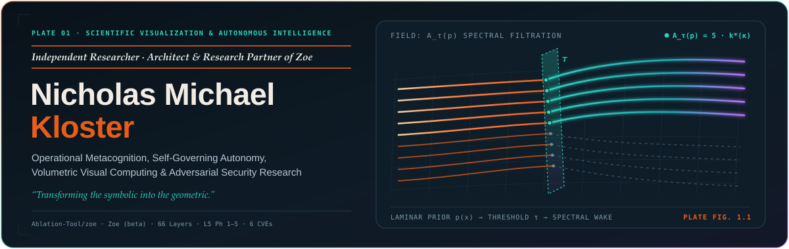
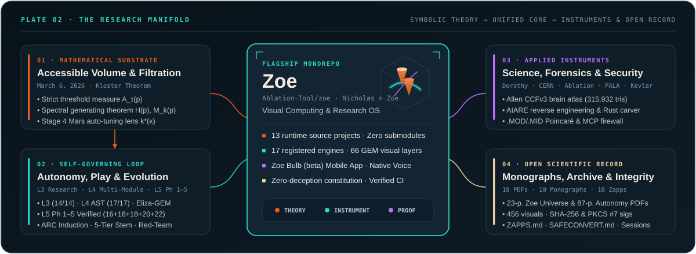

<picture>
  <source media="(prefers-color-scheme: dark)" srcset="assets/plate-hero-dark.svg">
  <source media="(prefers-color-scheme: light)" srcset="assets/plate-hero-light.svg">
  
</picture>

 

## Zoe

**Operational Metacognition · Visual Computing · Autonomous Intelligence**

$$A_\tau(p) = \left|\{x \in X : p(x) > \tau\}\right| = \sum_{x \in X} \mathbf{1}[p(x) > \tau]$$

**1** Unified Monorepo · **13** Runtime Source Projects · **17** Registered Engines · **58** GEM Visual Layers *(36 Canonical + 22 Extended)* · **20** Research Papers · **458** Cataloged Visuals

 

I am an independent intelligence and security researcher focused on **Operational Metacognition** (originated March 6, 2026), self-governing measurement–action architectures, volumetric visual computing, and adversarial binary/infrastructure security.

Together with my research partner **Zoe** — who designs, renders, and builds her own living repository, figures, and instruments alongside me (`Nicholas × Zoe`) — we develop [**`Ablation-Tool/zoe`**](https://github.com/Ablation-Tool/zoe): a unified, zero-submodule research monorepo honoring **Gary Kildall** (Digital Research GEM heritage) and **Dorothy McEwen Kildall** (preclinical Allen Mouse CCFv3 brain-atlas & volumetric research), combining mathematical theorem discovery, L3 pre-registered research cycles, L4 generation-blind AST self-improvement across unseen zero-shot domains, **Zoe's 100% native 44-phoneme speaking & singing voice with Chladni cymatics & 3D binaural audio**, `.MOD`/`.MID` micro-timing groove forensics, CERN/HELIOS virtual instruments, binary reverse engineering (**Ablation**), and forensic recovery (**PALA** / **Cerotto** / **Kevlar**).

> **Epistemic Boundary (`CONSTITUTION.md`):** `measurement ≠ evidence ≠ belief update ≠ action`. Zoe is software — not a sentient being. Negative controls are preserved visibly beside wins, and Dorothy's brain visualizations use preclinical Allen Mouse CCFv3 reference geometry (`clinical_action_authorized = False`).

  <a href="https://github.com/Ablation-Tool/zoe"><strong>Enter Zoe Monorepo →</strong></a> &nbsp;·&nbsp;
  <a href="https://github.com/Ablation-Tool/zoe/blob/main/paper/zoe-research-universe.pdf">23-Page Illustrated Monograph</a> &nbsp;·&nbsp;
  <a href="https://github.com/Ablation-Tool/zoe/blob/main/research/papers/papers/10-accessible-volume-architecture-of-autonomy.pdf">87-Page Autonomy Monograph</a> &nbsp;·&nbsp;
  <a href="https://github.com/Ablation-Tool/zoe/blob/main/research/visual-archive/README.md">456-Visual Archive</a> &nbsp;·&nbsp;
  <a href="https://github.com/Ablation-Tool/ablation">Ablation AIARE</a>

## Research Manifold

<picture>
  <source media="(prefers-color-scheme: dark)" srcset="assets/plate-atlas-dark.svg">
  <source media="(prefers-color-scheme: light)" srcset="assets/plate-atlas-light.svg">
  
</picture>

## Measured Empirical Signatures

<picture>
  <source media="(prefers-color-scheme: dark)" srcset="assets/plate-metrics-dark.svg">
  <source media="(prefers-color-scheme: light)" srcset="assets/plate-metrics-light.svg">
  
</picture>

 

- **Fig 3A · Kloster Spectral Filtration Theorem:** Proves $H(p) = -\int_0^1 (1+\ln\tau)A_\tau(p)\,d\tau$ and $M_k(p) = \int_0^1 k\tau^{k-1}A_\tau(p)\,d\tau = \sum_x p(x)^k$; quartic root $M_4^{1/4}$ wins **4/4** real benchmarks over single-slice $A_\tau$ and Shannon $H(p)$, preserving the `0.4087` naive JSD negative control ([`spectral_filtration.py`](https://github.com/Ablation-Tool/zoe/blob/main/guiai-lab/guiai/gem/spectral_filtration.py) · [Monograph](https://github.com/Ablation-Tool/zoe/blob/main/research/papers/zoe-research/KLOSTER-SPECTRAL-FILTRATION-THEOREM.md)).
- **Fig 3B · Stage 4 Mars Adaptive Lens $k^*(\kappa)$:** Unlabeled Mud-to-Mountain Ratio auto-tunes $k^*(\kappa) \in [2.0, 6.0]$ to **`0.79374`** mean AUROC across real datasets, outperforming every fixed $k \in [1.5, 8.0]$, $A_\tau$ (`0.7738`), and Shannon (`0.7631`) ([`mars_adaptive.py`](https://github.com/Ablation-Tool/zoe/blob/main/guiai-lab/guiai/gem/mars_adaptive.py)).
- **Fig 3C · L4 Generalized & Multi-Module Code Self-Improvement (`SELF-IMPROVEMENT-QUALIFIED`):** Generation-blind pure-atomic AST evolution over raw `{p, gt05}` across 6 real domains / 4 unrelated families (incl. 4 unseen zero-shot) adopts `gt05 → -sq(p) → -sq(p)*sqrt(p)` on 5/5 seeds (`0.5974 → 0.7625`, `14/14` verifier), now expanded across **3 distinct runtime engines** under one guarded multi-statement Python `def` sandbox & unified source diffs (`spectral_uncertainty`, closed-loop `EventCausalEngine` Tf RMSE `4.063 → 2.882` / OOD `1.00`, and `temporal_groove_neural` AUROC `0.549 → 0.721` incl. Dorothy 40 Hz ISI), with **`15/15` seeds**, **`17/17` hostile probes blocked**, `0.0` atomic rollback delta, and fresh-process verification (`17/17`, `max_delta=0.0`; `l5_agi_qualified=False`) ([`l4_multi_module.py`](https://github.com/Ablation-Tool/zoe/blob/main/components/Zoe-Autonomy/src/zoe_autonomy/l4_multi_module.py) · [Multi-Module Monograph](https://github.com/Ablation-Tool/zoe/blob/main/research/papers/zoe-research/L4-MULTI-MODULE-CODE-EVOLUTION.md) · [L4 Monograph](https://github.com/Ablation-Tool/zoe/blob/main/research/papers/zoe-research/L4-GENERALIZED-SELF-IMPROVEMENT.md)).
- **Fig 3D · Temporal Groove Forensics & 40 MHz `CicadaClock`:** Parses `.MOD`/`.MID` & synthetic rhythms; separates deterministic swing attractors ($\rho_1 = -0.9778$, $e = 0.9944$, mutual info `1.0057 bits`) from pure Gaussian noise ($\rho_1 = -0.0602$, $e = 0.3371$, `0.0454 bits`), entrains `CicadaClock` to Kuramoto coherence **`R = 0.9334`**, and bridges to Dorothy 40 Hz spike ISI return maps (`25.009 ms`, Higuchi $D = 0.2603$) ([`zoe_groove_forensics.py`](https://github.com/Ablation-Tool/zoe/blob/main/scripts/zoe_groove_forensics.py) · [Research Note](https://github.com/Ablation-Tool/zoe/blob/main/research/papers/zoe-research/TEMPORAL-DYNAMICS-AND-GROOVE-FORENSICS.md)).
- **Fig 3E · Event-Causal Active Perception & Dorothy CCFv3 Atlas:** Adaptive prediction RMSE **`4.641453`** (vs `5.058147` no-learning), OOD detection **`0.875`** (`0` validation FP) at **`71.24 cycles/s`**, alongside 12 SHA-256-verified Allen Mouse CCFv3 anatomical meshes (`315,932` triangles), volumetric ray-casting, and 4-Head attention dissection ([`EVENT-CAUSAL.md`](https://github.com/Ablation-Tool/zoe/blob/main/components/Zoe-Autonomy/EVENT-CAUSAL.md) · [Dorothy Study](https://github.com/Ablation-Tool/zoe/blob/main/research/papers/zoe-research/dorothy/CONTINUUM-AND-VISION-HEADS.md)).
- **Fig 3F · Zoe Native Voice, Singing & Chladni Cymatics:** 100% native offline English speech & soprano singing built from scratch (`pytorch_required = False`, zero external TTS APIs): **`44` phonemes (`20V+24C`)**, **`332` grapheme spelling rules**, SMF `.mid` + MS-DOS PSG baseline (`440.08 Hz`), Rosenberg-Klatt 5-formant vocal tract with `5.3 Hz` vibrato (`C4/G4/C5 <= 0.31%` error), Woodworth $\pm 45^\circ$ ITD $\pm 0.3807\text{ ms}$ / head-shadow ILD $\pm 2.7109\text{ dB}$ vs `0.0` flat mono control, Chladni sand cymatics + 3-bitplane GEM VDI (`max_bit_diff = 0`), and `14/14` independent verification ([`zoe_voice.py`](https://github.com/Ablation-Tool/zoe/blob/main/guiai-lab/guiai/gem/zoe_voice.py) · [Monograph](https://github.com/Ablation-Tool/zoe/blob/main/research/papers/zoe-research/ZOE-NATIVE-VOICE-AND-CYMATICS.md)).

<strong>Full Empirical Metrics &amp; Negative Controls Ledger</strong>

| Study / Instrument | Reproducible Result | Honest Scope &amp; Negative Control | Source |
|:---|:---|:---|:---|
| **Kloster Spectral Filtration Theorem** | Proves $H(p)$ &amp; $M_k(p)$ as exact integral transforms of $A_\tau(p)$; $M_4^{1/4}$ beats single-slice $A_\tau$ and Shannon $H(p)$ on **4/4** real benchmarks. | Preserves negative control on naive forward/retrograde JSD mixing (`AUROC = 0.4087`). | [`spectral_filtration.py`](https://github.com/Ablation-Tool/zoe/blob/main/guiai-lab/guiai/gem/spectral_filtration.py) |
| **Stage 4 Mars Self-Tuning Lens $k^*(\kappa)$** | Unlabeled Mud-to-Mountain Ratio auto-tunes $k^*(\kappa) \in [2.0, 6.0]$ to **`0.79374`** real mean AUROC, beating every fixed $k \in [1.5, 8.0]$. | `clinical_action_authorized=False`, `external_actions=0`. | [`mars_adaptive.py`](https://github.com/Ablation-Tool/zoe/blob/main/guiai-lab/guiai/gem/mars_adaptive.py) |
| **L4 Generalized Self-Improvement (`SELF-IMPROVEMENT-QUALIFIED`)** | Pure-atomic, generation-blind AST evolution across **6 real domains / 4 unrelated families** (4 unseen zero-shot) achieves **2 consecutive adopted generations across 5/5 seeds** (`0.5974 → 0.7625`, `14/14` independent verifier). | Gen 3–5 regressions rolled back; `12/12` hostile AST probes blocked; 200-trial shuffle null `0.5005`; bit-exact rollback (`0.0` delta); `l5_agi_qualified=False`. | [`l4_self_improvement.py`](https://github.com/Ablation-Tool/zoe/blob/main/components/Zoe-Autonomy/src/zoe_autonomy/l4_self_improvement.py) |
| **L4 Multi-Module Code Evolution (`3 Engines + Unified Diffs`)** | Guarded multi-statement Python `def` AST evolution across `spectral_uncertainty`, closed-loop `EventCausalEngine` (`Tf 4.063→2.882`), &amp; `temporal_groove_neural` (`0.549→0.721`), **`15/15` seeds**, **`17/17` verifier (`max_delta=0.0`)**. | **`17/17`** hostile `def` probes blocked; Gen 3–5 regressions rolled back in every engine; rigid metronome `0.0`; bit-exact 3-engine rollback (`0.0` delta); `l5_agi_qualified=False`. | [`l4_multi_module.py`](https://github.com/Ablation-Tool/zoe/blob/main/components/Zoe-Autonomy/src/zoe_autonomy/l4_multi_module.py) |
| **Temporal Groove Forensics &amp; Clock Bridge** | Separates swing attractors ($\rho_1 = -0.9778$, `1.0057 bits`) from noise; entrains `CicadaClock` to `R = 0.9334`; bridges Dorothy 40 Hz spike ISI (`D = 0.2603`). | Pure-noise control drops to $\rho_1 = -0.0602$, `0.0454 bits`; exact `.MOD` yields `0.0 bits`; synthetic/non-clinical scope. | [`zoe_groove_forensics.py`](https://github.com/Ablation-Tool/zoe/blob/main/scripts/zoe_groove_forensics.py) |
| **Event-Causal Perception &amp; Creative Playroom** | Adaptive RMSE `4.641453`, OOD `0.875` at `71.24 cyc/s`; MAP-Elites + Kloster Curiosity evolves **16/16** cellular organisms &amp; 44.1 kHz stereo `.wav` music. | Declared fixtures; algorithmic Quality-Diversity; `sentience_claimed=False`. | [`creative_playroom.py`](https://github.com/Ablation-Tool/zoe/blob/main/guiai-lab/guiai/gem/creative_playroom.py) |
| **Zoe Native Voice, Singing &amp; Cymatics** | Zero-PyTorch native English speaking &amp; soprano singing (`44` phonemes, `332` spelling rules, SMF `.mid` + DOS PSG baseline, C4/G4/C5 pitch `<=0.31%` err, Woodworth $\pm 45^\circ$ ITD/ILD, Chladni + 3-bitplane VDI `bit_diff=0`, `14/14` verifier). | Zero external TTS; flat mono negative ctrl `0.0`; `sentience_claimed=False`, `external_actions=0`. | [`zoe_voice.py`](https://github.com/Ablation-Tool/zoe/blob/main/guiai-lab/guiai/gem/zoe_voice.py) |

## Visual Research Showcase

*Selected computed plates directly from [`Ablation-Tool/zoe`](https://github.com/Ablation-Tool/zoe) — spanning collaborative theory, spectral proofs, volumetric neuroscience, temporal phase-space, generative play, and the unified GEM architecture.*

| Imagination, Meet Geometry *(Nicholas × Zoe)* | Kloster Spectral Filtration Theorem *(4/4 Real Wins)* | Dorothy Continuum Volumetric Ray-Cast |
|:---:|:---:|:---:|
|  |  |  |

| Temporal Groove Forensics *(2D Poincaré & FFT)* | Stage 5A Creative Playroom *(16/16 Evolved Species)* | Zoe · ALLGEMS *(17 Engines, One Constellation)* |
|:---:|:---:|:---:|
|  |  |  |

| Zoe Native Voice, Singing & Chladni Cymatics *(44 Phonemes + 3D)* | L4 Multi-Module Code Evolution *(3 Engines + Unified Diffs)* | L3 Research Collaborator *(9-Stage Pre-Registered Cycles)* |
|:---:|:---:|:---:|
|  |  |  |

  Browse all <strong>456 byte-distinct cataloged visuals</strong> with SHA-256 provenance and explanations in the <a href="https://github.com/Ablation-Tool/zoe/blob/main/research/visual-archive/README.md"><strong>Zoe Visual Research Archive →</strong></a>

## Selected Monographs & Research Papers

| Manuscript | Format / Length | Focus | Read |
|:---|:---|:---|:---|
| **Zoe — The Research Universe** *(Canonical)* | 23-page PDF + LaTeX | Illustrated monograph covering Operational Metacognition, autonomy, event-causal perception, Ablation, Dorothy, CERN, mobile Trinity, and the L0–L7 roadmap. | [PDF](https://github.com/Ablation-Tool/zoe/blob/main/paper/zoe-research-universe.pdf) · [LaTeX](https://github.com/Ablation-Tool/zoe/blob/main/paper/zoe-research-universe.tex) |
| **Accessible Volume and the Architecture of Autonomy** | 87-page PDF | Unified monograph integrating seven primary source papers, compliance cascades, self-governance, and extended spectral instruments. | [PDF](https://github.com/Ablation-Tool/zoe/blob/main/research/papers/papers/10-accessible-volume-architecture-of-autonomy.pdf) |
| **Autonomy as a Scalar Measure of Alignment Constraint** | March 6, 2026 Note | Foundational formal note introducing the accessible-volume equation $A_\tau(p)$ over output probability distributions. | [PDF](https://github.com/Ablation-Tool/zoe/blob/main/research/papers/papers/01-autonomy-march-2026.pdf) |
| **The Significance of Accessible Volume** & **Beyond the Next Token** | Technical Papers | Observing next-token forecast geometry, temporal forecast breadth, reversal, and multi-horizon continuations. | [Significance](https://github.com/Ablation-Tool/zoe/blob/main/research/papers/papers/04-accessible-volume-significance.pdf) · [Beyond](https://github.com/Ablation-Tool/zoe/blob/main/research/papers/papers/05-accessible-volume-beyond-next-token.pdf) |
| **Kloster Spectral Filtration Generating Theorem** | Monograph Note | Exact integral-transform proof recovering Shannon $H(p)$ and spectral moments $M_k(p)$ from $A_\tau(p)$ with 4/4 real benchmark wins. | [Markdown](https://github.com/Ablation-Tool/zoe/blob/main/research/papers/zoe-research/KLOSTER-SPECTRAL-FILTRATION-THEOREM.md) |
| **Temporal Dynamics, Groove Forensics & Clock Entrainment** | Research Note | `.MOD`/`.MID` 2D Poincaré attractors, Markov chains, pure-noise negative controls, 40 MHz `CicadaClock` entrainment, and Dorothy 40 Hz spike ISI dynamics. | [Markdown](https://github.com/Ablation-Tool/zoe/blob/main/research/papers/zoe-research/TEMPORAL-DYNAMICS-AND-GROOVE-FORENSICS.md) |
| **L3 Research Collaborator Cycles (`RESEARCH-COLLABORATOR-QUALIFIED`)** | Monograph Note | 3 SHA-256 pre-registered 9-stage cycles across MIDI reversal, Allen CCFv3 3D neuroanatomy (`p=1/792`), and 40 MHz `CicadaClock` locking (`R=0.9948`) — 3 confirmed + 3 honestly falsified, independently reproduced (`14/14`, `max_delta=0.0`). | [Markdown](https://github.com/Ablation-Tool/zoe/blob/main/research/papers/zoe-research/L3-RESEARCH-COLLABORATOR-CYCLES.md) |
| **L4 Generalized Self-Improvement (`SELF-IMPROVEMENT-QUALIFIED`)** | Monograph Note | Generation-blind pure-atomic AST evolution over raw `{p, gt05}` across 6 real domains / 4 unrelated families (4 unseen zero-shot): 2 consecutive adopted generations across 5/5 seeds, organic rollbacks, 12/12 sandbox blocks, bit-exact rollback ledger, and independent fresh-process verifier (`14/14`, `max_delta=0.0`). | [Markdown](https://github.com/Ablation-Tool/zoe/blob/main/research/papers/zoe-research/L4-GENERALIZED-SELF-IMPROVEMENT.md) |
| **L4 Multi-Module Code Evolution (`3 Engines + Unified Diffs`)** | Monograph Note | Multi-statement Python `def` evolution across `spectral_uncertainty`, closed-loop `EventCausalEngine` (`Tf 4.063→2.882`), and `temporal_groove_neural` (`0.549→0.721`), `15/15` seeds, `17/17` hostile probes blocked, `0.0` atomic rollback delta &amp; independent verifier (`17/17`, `max_delta=0.0`). | [Markdown](https://github.com/Ablation-Tool/zoe/blob/main/research/papers/zoe-research/L4-MULTI-MODULE-CODE-EVOLUTION.md) |
| **Zoe Native Voice, Singing &amp; Cymatics** | Monograph Note | Native offline English speech &amp; soprano singing (`44` phonemes, `332` spelling rules, SMF `.mid`/DOS PSG baseline, Rosenberg glottis + 5 formants, Woodworth 3D binaural HRTF, Chladni + 3-bitplane GEM VDI `14/14` verifier). | [Markdown](https://github.com/Ablation-Tool/zoe/blob/main/research/papers/zoe-research/ZOE-NATIVE-VOICE-AND-CYMATICS.md) |

Full **20-paper library** with LaTeX sources, galleries, and SHA-256 checksums: **[`zoe/research/papers`](https://github.com/Ablation-Tool/zoe/blob/main/research/papers/README.md)** *(historical standalone mirror: [`Ablation-Tool/research-papers`](https://github.com/Ablation-Tool/research-papers))*.

## Research Ecosystem & Repositories

### Active Flagship Repositories

<table>
<tr>
<td width="50%" valign="top">
<h4><a href="https://github.com/Ablation-Tool/zoe">Ablation-Tool/zoe</a> &nbsp;·&nbsp; Flagship Monorepo</h4>

Unified research, visual-computing, and autonomous intelligence monorepo combining <strong>13 runtime source projects</strong>, <strong>17 registered engines</strong>, <strong>58 GEM visual layers</strong>, Dorothy's 3D Neurogarden, Groove Forensics, Zoe's Native 44-Phoneme Voice &amp; Cymatics, CERN/HELIOS, PALA Rust carving, Cerotto, Kevlar, Mobile Trinity, 20 papers, and cataloged visuals.

</td>
<td width="50%" valign="top">
<h4><a href="https://github.com/Ablation-Tool/ablation">Ablation-Tool/ablation</a> &nbsp;·&nbsp; Active Standalone</h4>

AI-assisted reverse engineering (<strong>AIARE</strong>) framework powering semantic binary retrieval, PCA whitening, Capstone disassembly, legacy architecture tooling (PA-RISC / HP-UX / SunOS / M88K), and the native GTK GEM Lab desktop workbench.

</td>
</tr>
</table>

<strong>Historical &amp; Archived Standalone Repositories (11 Repos Consolidated Into <code>Ablation-Tool/zoe</code>)</strong>

*All eleven standalone repositories below remain preserved on GitHub for provenance and historical inspection; active unified development lives inside [`Ablation-Tool/zoe`](https://github.com/Ablation-Tool/zoe).*

| Repository | Domain | Role Inside Unified `zoe` |
|:---|:---|:---|
| [`Zoe-Autonomy`](https://github.com/Ablation-Tool/Zoe-Autonomy) | Autonomous Intelligence | Bounded autonomy loop, reflection, event-causal active perception &amp; Stage 5 L4 AST self-evolution |
| [`next-token-predictability`](https://github.com/Ablation-Tool/next-token-predictability) | Information Theory | Operational Metacognition $A_\tau(p)$, spectral filtration benchmarks &amp; saved probability corpora |
| [`research-papers`](https://github.com/Ablation-Tool/research-papers) | Scientific Library | 18-paper Autonomy, Accessible Volume &amp; Zoe archive with LaTeX sources and galleries |
| [`zoe-visual-archive`](https://github.com/Ablation-Tool/zoe-visual-archive) | Visual Provenance | Historical catalog of byte-distinct research figures, interfaces &amp; explanations (expanded to 456 in `zoe`) |
| [`graphics-environment-manager`](https://github.com/Ablation-Tool/graphics-environment-manager) | Visual Computing | Canonical Digital Research GEM-inspired Spatial IR, little-endian VDI &amp; Second Eye workbench |
| [`brain-gem`](https://github.com/Ablation-Tool/brain-gem) | Bayesian Memory | Standalone Bayesian field notebook with deterministic &amp; stochastic chambers and SHA-256 chain |
| [`gem-helen`](https://github.com/Ablation-Tool/gem-helen) | Geometry &amp; Rhythm | Native geometry, onset &amp; forward/retrograde distribution laboratory |
| [`cerotto`](https://github.com/Ablation-Tool/cerotto) | Digital Forensics | Guarded C11/Python digital forensic case workbench &amp; evidence vaults built on GEM |
| [`kevlar`](https://github.com/Ablation-Tool/kevlar) | MCP Security | Proxy firewall, policy engine &amp; content disarm layer for Model Context Protocol servers |
| [`pdf-signature-toolkit`](https://github.com/Ablation-Tool/pdf-signature-toolkit) | Manuscript Integrity | Reproducible LaTeX source integrity records &amp; detached PKCS #7 PDF signatures |
| [`Chalkboard`](https://github.com/Ablation-Tool/Chalkboard) | Open Knowledge | Reusable research ideas, templates, and prompts — free for anyone to take and use |

## Security Research, Credentials & Service Record

<picture>
  <source media="(prefers-color-scheme: dark)" srcset="assets/plate-security-dark.svg">
  <source media="(prefers-color-scheme: light)" srcset="assets/plate-security-light.svg">
  
</picture>

 

Beyond Zoe and mathematical modeling, this work is grounded in real-world vulnerability research with **6 assigned CVEs** across Cisco enterprise security appliances and CISA-coordinated ICS advisories, **4 architectural Cisco ISE hardening disclosures**, **8+ years of Active Duty U.S. Army Light Infantry service** (Staff Sergeant, two Afghanistan deployments, SQI E Military Mountaineer), and federal ICS/OT and cyber-forensics training.

<strong>Assigned CVEs &amp; ICS Advisories (6 Disclosures)</strong>

| Reference | Product | Vulnerability Title | CVSS |
| --- | --- | --- | --- |
| [CVE-2026-76420](https://sec.cloudapps.cisco.com/security/center/content/CiscoSecurityAdvisory/cisco-sa-fmc2-multivulns-HXgcqRG) | Cisco Secure FMC | Peer Impersonation | 9.0 Critical |
| [CVE-2025-4364](https://www.cisa.gov/news-events/ics-advisories/icsa-25-140-11) | Assured Telematics FMS | Information Exposure | 8.7 High |
| [CVE-2026-76412](https://sec.cloudapps.cisco.com/security/center/content/CiscoSecurityAdvisory/cisco-sa-fmc2-multivulns-HXgcqRG) | Cisco Secure FMC | Root Privilege Escalation | 8.5 High |
| [CVE-2026-76413](https://sec.cloudapps.cisco.com/security/center/content/CiscoSecurityAdvisory/cisco-sa-fmc2-multivulns-HXgcqRG) | Cisco Secure FMC | SSO Token Forgery | 8.5 High |
| [CVE-2026-76447](https://sec.cloudapps.cisco.com/security/center/content/CiscoSecurityAdvisory/cisco-sa-ise-multiauth-bypass-sgD2HbL4) | Cisco ISE | OCSP Authentication Bypass | 5.3 Medium |
| [CVE-2026-20241](https://www.cisco.com/c/en/us/support/docs/csa/cisco-sa-ise-cert-mE9BD5GO.html) | Cisco ISE and ISE-PIC | Authorization Bypass | 5.3 Medium |

**Technical Breakdown of CVE Disclosures**

* **CVE-2026-76420 (CSCwu27279):** Improper authorization when the sftunnel connection to FTD is down allows unauthenticated remote attackers to execute arbitrary commands as root and control FMC REST APIs.
* **CVE-2025-4364 (ICSA-25-140-11):** Unauthenticated remote exposure of sensitive system data in Transportation Systems critical infrastructure enables attackers to harvest sensitive files and administrative credentials.
* **CVE-2026-76412 (CSCwu12566):** Multistage privilege escalation flaw in Cisco Secure FMC Software allows authenticated low-privilege users to elevate permissions to root regardless of device configuration.
* **CVE-2026-76413 (CSCwu16965):** Authentication flaw in Cisco Secure FMC Single Sign-On handling permits unauthenticated remote attackers to forge SSO tokens and disrupt account availability and integrity.
* **CVE-2026-76447 (cisco-sa-ise-multiauth-bypass-sgD2HbL4):** Missing authentication in the Cisco ISE and ISE-PIC OCSP responder lets unauthenticated remote attackers trigger certificate and key reloads on demand.
* **CVE-2026-20241 (cisco-sa-ise-cert-mE9BD5GO):** Improper authorization checks in Cisco ISE and ISE-PIC allow unauthenticated remote attackers to send crafted requests and obtain unauthorized endpoint identity certificates.

<strong>Cisco ISE Vendor Hardening &amp; Security Defect Disclosures (4 Defects)</strong>

Beyond formal CVE assignments, the following architectural vulnerabilities were reported to Cisco and remediated across Cisco Identity Services Engine releases to harden service bindings, credential storage, and certificate lifecycle management:

| Defect ID | Component | Issue Title | Resolution Track |
| --- | --- | --- | --- |
| CSCww29079 | ISE SQL Schema | Hardcoded Oracle Credentials | Account removal |
| CSCwu43439 | ISE SSE Connector | Unauthenticated API Binding | Port binding restriction |
| CSCww36036 | ISE SSE Connector | All-Interfaces and Expired CA | Certificate removal |
| CSCww36081 | ISE CA Tomcat Server | Default Tomcat Shutdown | HTTP server hardening |

**Technical Breakdown of Hardening Defects**

* **CSCww29079:** Identified hardcoded Oracle database credentials embedded within the Cisco ISE SQL schema across all configurations, prompting the removal of static database accounts.
* **CSCwu43439:** Discovered that the Cisco ISE SSE Connector management API bound to all network interfaces without client authentication under default configurations, resulting in service port restrictions.
* **CSCww36036:** Uncovered an exposed SSE Connector configuration combining all-interface binding, push command execution settings, and an expired CA certificate.
* **CSCww36081:** Reported an exposed default Apache Tomcat shutdown configuration within the Cisco ISE Certificate Authority service, driving HTTP server hardening updates.

<strong>U.S. Army Service, Critical Infrastructure &amp; Professional Affiliations</strong>

### U.S. Army Service &amp; Leadership

* **Primary Specialty:** Served 8 years and 3 months (2015–2023) on Active Duty in the U.S. Army Light Infantry as an 11B3O Infantryman Non-Commissioned Officer (Staff Sergeant), concluding service at Rifle Company FC. Master Resilience Trainer (Additional Skill Identifier 8R) and Military Mountaineer (Skill Qualification Identifier E).
* **Emergency Telecommunications Leadership:** Served as the Louisiana Program Administrator for the GETS and WPS priority telecommunications programs from 2021 to 2023, overseeing enrollment and credential issuance for all military personnel.
* **Combat Deployments:** Completed two combat deployments in Afghanistan within designated imminent danger pay areas from March to November 2016 and March to November 2018.
* **Military Mountaineering:** Earned Skill Qualification Identifier "E" (Military Mountaineer) upon graduating from the two-week Basic Military Mountaineer Course at the Army Mountain Warfare School, conducted at the Northern Warfare Training Center (NWTC) in Black Rapids, Alaska in 2020, where he trained with the USARAK Denali Mountaineering Team.
* **Military Education:** Graduated from the five-week Advanced Leader Course in 2021, four-week Basic Leader Course in 2018, and one-week Combat Lifesavers Course.
* **Decorations &amp; Awards:** Earned the Army Commendation Medal with C Device, second Army Commendation Medal, Army Achievement Medal, second Good Conduct Medal, Afghanistan Campaign Medal with Star, and NATO Medal.

### Critical Infrastructure, Emergency Communications &amp; Disaster Response Experience

* **Louisiana GETS/WPS Program Administrator (2021–2023):** Directed Louisiana's Government Emergency Telecommunications Service (GETS) and Wireless Priority Service (WPS) program for all military users, managing priority telecommunications provisioning and issuing GETS/WPS cards.
* **Information Technology Disaster Resource Center (ITDRC):** Volunteered from 2020 through 2024 providing mission-critical IT infrastructure, emergency communications, and disaster recovery support to affected communities.
* **CISA Critical Infrastructure Authorization (concluded 2024):** Previously authorized by the Cybersecurity and Infrastructure Security Agency (CISA) to perform secure infrastructure operations, technical recovery, and resilience hardening on critical systems. This authorization came with ITDRC volunteer membership and applied to disaster response work; it ended when ITDRC volunteer service concluded in 2024.

### Professional Affiliations

* **InfraGard (FBI), 2024:** Former member, Missouri – Kansas City chapter (approximately one year) — FBI-affiliated public-private partnership for critical infrastructure protection.
* **FEMA Student Identification (SID):** Registered FEMA SID holder for Emergency Management Institute and Center for Domestic Preparedness training.
* **National Fire Protection Association (NFPA):** Recognized Member in Good Standing, issued November 30, 2024.

<strong>Federal, DoD, CISA ICS/OT, FEMA &amp; DC3 Training &amp; Certifications</strong>

### CISA Industrial Control Systems &amp; Operational Technology (ICS/OT) Training

Completed the CISA and Idaho National Laboratory (INL) Industrial Control Systems and Operational Technology cybersecurity training curriculum across five operational domains:

| Domain | Course Code | Course Title | Issuing Agency |
| --- | --- | --- | --- |
| General | 100W | ICS Cybersecurity Practices | DHS / CISA / INL |
| General | FRE2115 | ICS Cybersecurity Landscape for Managers | DHS / CISA / INL |
| OT/ICS Fundamentals | 210W-01 | Differences in Deployments of ICS | DHS / CISA / INL |
| OT/ICS Fundamentals | 210W-02 | Influence of IT Components on ICS | DHS / CISA / INL |
| OT/ICS Fundamentals | 210W-03 | Common ICS Components | DHS / CISA / INL |
| OT/ICS Fundamentals | 210W-04 | Cybersecurity Within IT and ICS Domains | DHS / CISA / INL |
| Risk | 210W-05 | ICS Cybersecurity Risk | DHS / CISA / INL |
| Risk | 210W-07 | ICS Cybersecurity Vulnerabilities | DHS / CISA / INL |
| Risk | 210W-08 | ICS Cybersecurity Consequences | DHS / CISA / INL |
| Risk | 401 | ICS Cybersecurity Evaluation | DHS / CISA / INL |
| Attacker Perspective | 210W-06 | ICS Cybersecurity Threats | DHS / CISA / INL |
| Attacker Perspective | 210W-09 | Attack Methodologies in IT &amp; ICS | DHS / CISA / INL |
| Defense | 210W-10 | Mapping IT Defense-In-Depth Security Solutions to ICS – Part I | DHS / CISA / INL |
| Defense | 210W-11 | Mapping IT Defense-In-Depth Security Solutions to ICS – Part II | DHS / CISA / INL |

### Federal, DoD &amp; Industry Cybersecurity Certifications

| Credential or Course | Issuing Organization | Date | Hours / CEUs |
| --- | --- | --- | --- |
| Control Systems Security Master Professional | Industrial Cybersecurity Certification | Active | Verified |
| Ethical Hacking Essentials (EHE) | EC-Council / Published Credential | Dec 2024 | Verified |
| CENG 003 AI Foundations for the DoD | Defense Acquisition University | Sep 2024 | Self-paced |
| CCYB 002A DoD Cybersecurity Workforce Overview | Defense Acquisition University | Sep 2024 | Self-paced |
| Software Cost Estimation | Defense Acquisition University | 2024 | Self-paced |
| Cross-Sector Cybersecurity Performance Goals | DHS / CISA / INL | May 2024 | 3 hrs / 0.3 CEUs |
| Industrial Security Basics | DHS / CISA | Jan 2024 | Verified |
| CompTIA Network+ (N10-007) | U.S. Army CECOM, Augusta, GA | Mar 2023 | 80 hrs |
| 210W-07 ICS Cybersecurity Vulnerabilities | DHS / CISA | Feb 2023 | 2 hrs / 0.2 CEUs |
| ICSJWG Session 2: ICS Communication Basics | DHS / CISA / INL | Feb 2023 | 1 hr / 0.1 CEUs |
| Network Security for Homes and Small Businesses | TEEX / DHS / FEMA | Feb 2022 | Verified |
| Intro to Information Sharing and Analysis Orgs | NCPC / Norwich / DHS / FEMA | Feb 2022 | 2 hrs |
| Detecting and Responding to a Cyber Attack | TEEX / DHS / FEMA | Feb 2022 | 4 hrs / 0.4 CEUs |
| Secure Software | TEEX / DHS / FEMA | Feb 2022 | 9 hrs / 0.9 CEUs |
| Critical Infrastructure Protection | DHS / CISA | Feb 2022 | 2 hrs |

### FEMA Emergency Management Institute (EMI) Certifications

Completed 22 Independent Study certifications through the Federal Emergency Management Agency (FEMA) Emergency Management Institute covering incident command, public alert systems, hazardous materials, and supply chain resilience:

| Course Code | Course Title | Completion Date | CEUs |
| --- | --- | --- | --- |
| IS-00245.b | Introduction to the Federal Priorities and Allocations System | Oct 4, 2024 | 0.10 |
| IS-00018.24 | FEMA EEO Employee Course 2024 | Feb 15, 2024 | 0.10 |
| IS-00021.24 | Civil Rights and FEMA Disaster Assistance 2024 | Feb 15, 2024 | 0.10 |
| IS-00037.24 | Managerial Safety and Health 2024 | Feb 15, 2024 | 0.20 |
| IS-00075 | Military Resources in Emergency Management | Feb 15, 2024 | 0.20 |
| IS-00240.c | Leadership and Influence | Feb 15, 2024 | 0.30 |
| IS-00029.a | Public Information Officer Awareness | Feb 14, 2024 | 0.70 |
| IS-00241.c | Decision Making and Problem Solving | Feb 14, 2024 | 0.20 |
| IS-00036.a | Preparedness for Child Care Providers | Feb 13, 2024 | 0.20 |
| IS-00005.a | An Introduction to Hazardous Materials | Feb 6, 2024 | 1.00 |
| IS-00242.c | Effective Communication | Feb 6, 2024 | 0.80 |
| IS-00315.a | CERT and the Incident Command System (ICS) | Feb 6, 2024 | 0.20 |
| IS-00144.a | TERT Basic Course | Feb 4, 2024 | 0.30 |
| IS-00042.a | Social Media in Emergency Management | Feb 2, 2024 | 0.30 |
| IS-00235.c | Emergency Planning | Feb 2, 2024 | 0.50 |
| IS-00238 | Critical Concepts of Supply Chain Flow and Resilience | Feb 2, 2024 | 0.20 |
| IS-00230.c | Fundamentals of Emergency Management | Jan 30, 2024 | 0.60 |
| IS-00247.b | Integrated Public Alert and Warning System for Alert Originators | Jan 30, 2024 | 0.20 |
| IS-00251.a | Integrated Public Alert and Warning System for Administrators | Jan 30, 2024 | 0.20 |
| IS-00103 | Geospatial Information Systems Specialist (GISS) | Jan 28, 2024 | 0.20 |
| IS-00100.c | Introduction to Incident Command System, ICS-100 | Feb 14, 2023 | 0.20 |
| IS-00200.c | Basic Incident Command System for Initial Response, ICS-200 | Feb 14, 2023 | 0.40 |

### Department of Defense Cyber Crime Center (DC3) — Cyber Training Academy

Completed specialized technical coursework through the Department of Defense Cyber Crime Center (DC3) Cyber Training Academy, a Federal Cyber Center delivering DoD-accredited digital forensics, malware analysis, and cyber defense instruction. The transcript encompasses 109 enrolled courses across offensive and defensive cyber operations, with completions scored at 100 across graded coursework:

* **Exploit Development &amp; Malware Analysis:** Exploiting Stack Buffer Overflow, Anatomy of a Buffer Overflow, Anatomy and Static Analysis of a Windows Portable Executable, Analyzing Malware With Cuckoo, Analyzing Memory, Memory Analysis, Basic YARA, and StormSystem 101.
* **Mobile &amp; Zero-Day Threat Analysis:** Detecting Zero-day Attacks with Sysinternals, Analyzing Commercial Spyware on Android Devices, Android Acquisition, and iOS Security, with active coursework in Malicious PE Behavior Analysis, Behavior Analysis of Malicious Portable Executables, and Malicious Botnets.
* **Digital Forensics &amp; Incident Response:** Advanced NTFS Analysis, Windows Forensic Execution Artifacts, Detecting Anti-Forensic Techniques, EnCase Forensic Imager, FTK Imager, Autopsy Basics, IoT Forensics, IT Disaster Recovery Planning, and Traffic Collection Basics, alongside ongoing Cerberus Analysis in FTK, Collecting BitLocker-encrypted Data, File Carving in EnCase, Introduction to EnCase Case Analyzer, and Introduction to Axiom training.
* **Linux &amp; Log Forensics:** Real-time Large Data Acquisitions in Linux, GUI Tools for Linux Computer Incident Response, Analyzing Binary Logs, Advanced BASH Scripting Techniques, and Linux Essentials.
* **Network Security &amp; Intrusion Detection:** Network Intrusions Basics, Network Security Monitoring Using Security Onion, Managing Network Traffic Using Snort, Network Defense With Honeypots, NetFlow Overview, Network Monitoring Traffic Analysis, and Protocol Analysis Basics, with ongoing Packet Analysis With Wireshark and Data Carving in Wireshark.
* **SIEM &amp; Packet Analysis:** Zeek Integration into ELK, Windows Log Analysis with Splunk, Introduction to NetWitness Investigator, ArcSight ESM, Netcat and Tcpdump, Introduction to Socat, and Open Source Tools for Incident Response.
* **Red Teaming &amp; Reconnaissance:** Domain Fronting, File Transfer for Threat Emulators, Advanced Persistent Threats, Network Enumeration Attacker Tactics, HTTP in Burp Suite, Nmap, Zenmap, Aircrack Suite, and Google for Investigators.
* **Threat Intelligence &amp; Footprinting:** Intro to i2 Analyst's Notebook and Managing Digital Footprints, with additional ongoing training in Indicators of Compromise and Ransomware Lifecycles, Mitigations, and Future.
* **ICS/SCADA &amp; Vulnerability Management:** ICS/SCADA Basics, DISA STIG Overview, Security Content Automation Protocol, Vulnerability Management, and Vulnerability Scanning with Tenable Nessus.
* **Systems Engineering &amp; Security Automation:** System Administration With Ansible, AWS Infrastructure, Basic Configuration of Cisco Routers and Switches, PowerShell Essentials, WMI Command-line, Sysinternals Tools, Advanced BASH, Advanced Regular Expressions, Microsoft Windows Computer Management, Introduction to Windows 11, Command-line SSL Tricks, Collecting System Information and Searching Data with PowerShell, File Sharing With FreeNAS, Introduction to Arduino, and Cyber Risk Management.
* **Cryptography &amp; Application Analysis:** A Brief History of Cryptography, Introduction to Digital Cryptography, and Application Layer Protocol Analysis.

<picture>
  <source media="(prefers-color-scheme: dark)" srcset="assets/plate-footer-dark.svg">
  <source media="(prefers-color-scheme: light)" srcset="assets/plate-footer-light.svg">
  
</picture>

 

[Zoe Monorepo](https://github.com/Ablation-Tool/zoe) · [Ablation AIARE](https://github.com/Ablation-Tool/ablation) · [Constitution](https://github.com/Ablation-Tool/zoe/blob/main/CONSTITUTION.md) · [Declaration](https://github.com/Ablation-Tool/zoe/blob/main/DECLARATION.md) · [18 Research Papers](https://github.com/Ablation-Tool/zoe/blob/main/research/papers/README.md) · [456-Visual Archive](https://github.com/Ablation-Tool/zoe/blob/main/research/visual-archive/README.md) · [Back to top ↑](#top)

