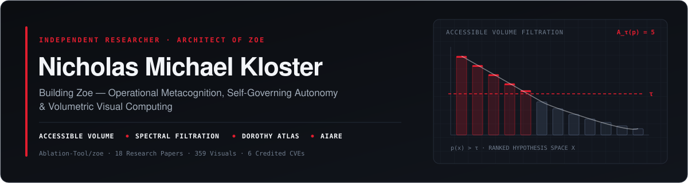
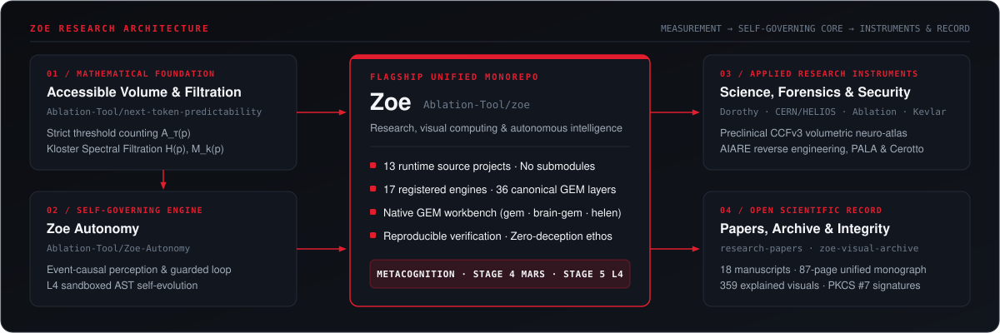

<picture>
  <source media="(prefers-color-scheme: dark)" srcset="assets/hero-dark.svg">
  <source media="(prefers-color-scheme: light)" srcset="assets/hero-light.svg">
  
</picture>

  <a href="#zoe">Zoe</a> &nbsp;·&nbsp;
  <a href="#architecture">Architecture</a> &nbsp;·&nbsp;
  <a href="#empirical-results">Empirical Results</a> &nbsp;·&nbsp;
  <a href="#visual-showcase">Visual Showcase</a> &nbsp;·&nbsp;
  <a href="#publications">Publications</a> &nbsp;·&nbsp;
  <a href="#repositories">Repositories</a> &nbsp;·&nbsp;
  <a href="#security--background">Security &amp; Background</a>

---

## Zoe

*Unified research, visual-computing, and autonomous intelligence — built with mathematical rigor, curiosity, and zero deception.*

$$A_\tau(p) = \left|\{x \in X : p(x) > \tau\}\right| = \sum_{x \in X} \mathbf{1}[p(x) > \tau]$$

**1** Unified Monorepo · **13** Source Projects · **17** Registered Engines · **36** Canonical GEM Layers · **18** Papers · **359** Archived Visuals

Zoe is developed as a general research collaborator centered on **Operational Metacognition** (originated March 6, 2026), **Dorothy's brain-cancer volumetric research** (honoring Dorothy McEwen Kildall), and **Digital Research GEM heritage** (honoring Gary Kildall). The unified monorepo integrates event-causal active perception, self-governing autonomy, CERN/HELIOS virtual instruments, reverse engineering (**Ablation**), and forensic recovery (**Cerotto** / **PALA**). Epistemic scope is explicitly preserved: Zoe is software, not a sentient being (`CONSTITUTION.md`), and Dorothy visualizations use preclinical Allen Mouse CCFv3 reference geometry rather than clinical patient data.

  <a href="https://github.com/Ablation-Tool/zoe"><strong>Explore Zoe →</strong></a> &nbsp;·&nbsp;
  <a href="https://github.com/Ablation-Tool/research-papers/blob/main/papers/10-accessible-volume-architecture-of-autonomy.pdf">Read the 87-Page Monograph</a> &nbsp;·&nbsp;
  <a href="https://github.com/Ablation-Tool/Zoe-Autonomy">Zoe-Autonomy Engine</a> &nbsp;·&nbsp;
  <a href="https://github.com/Ablation-Tool/zoe-visual-archive">359-Visual Archive</a>

---

<h2 id="architecture">Research Architecture</h2>

<picture>
  <source media="(prefers-color-scheme: dark)" srcset="assets/zoe-architecture-dark.svg">
  <source media="(prefers-color-scheme: light)" srcset="assets/zoe-architecture-light.svg">
  
</picture>

---

<h2 id="empirical-results">Verified Empirical Highlights</h2>

| Study / Instrument | Reproducible Result | Honest Scope &amp; Controls | Source |
|:---|:---|:---|:---|
| **Kloster Spectral Filtration Theorem** | Proves $H(p) = -\int_0^1 (1+\ln\tau)A_\tau(p)\,d\tau$ and $M_k(p) = \int_0^1 k\tau^{k-1}A_\tau(p)\,d\tau = \sum_x p(x)^k$; $M_4^{1/4}$ outperforms single-slice $A_\tau$ and Shannon $H(p)$ on **4/4** real benchmarks. | Preserves negative control on naive forward/retrograde JSD mixing (`AUROC = 0.4087`). | [`zoe`](https://github.com/Ablation-Tool/zoe) · [`next-token-predictability`](https://github.com/Ablation-Tool/next-token-predictability) |
| **Stage 4 Mars Self-Tuning Lens $k^*(\kappa)$** | Unlabeled Mud-to-Mountain Ratio auto-tunes $k^*(\kappa) \in [2.0, 6.0]$ to **`0.79374`** cross-domain real mean AUROC, beating fixed $k \in [1.5, 8.0]$, single-slice $A_\tau$ (`0.7738`), and Shannon (`0.7631`). | `clinical_action_authorized=False`, `external_actions=0`. | [`zoe`](https://github.com/Ablation-Tool/zoe) |
| **Stage 5 L4 Sandboxed AST Self-Evolution** | **3 consecutive autonomously adopted generations** across 4 unrelated real held-out domains (`0.5702 → 0.7849 → 0.7915 → 0.7976`, `+0.2274`), beating frozen Gen 2 on **4/4** domains. | Overfit Gen 4 probe cleanly rejected &amp; rolled back; hostile AST blocked; `l5_agi_qualified=False`. | [`Zoe-Autonomy`](https://github.com/Ablation-Tool/Zoe-Autonomy) · [`zoe`](https://github.com/Ablation-Tool/zoe) |
| **Event-Causal Perception &amp; Dorothy Atlas** | Adaptive prediction RMSE **`4.641453`** (vs `5.058147` no-learning); OOD detection **`0.875`** (`0` validation FP) at **`71.24 cycles/s`**; Allen Mouse CCFv3 geometry (12 structures, 315,932 triangles). | Preclinical reference geometry; declared synthetic &amp; `/dev/video0` fixtures. | [`Zoe-Autonomy`](https://github.com/Ablation-Tool/Zoe-Autonomy) · [`zoe`](https://github.com/Ablation-Tool/zoe) |

---

<h2 id="visual-showcase">Visual Research Showcase</h2>

| Unified GEM Workbench | Dorothy Volumetric Atlas (CCFv3) | Causal Chiasm &amp; Filtration Tomography |
|:---:|:---:|:---:|
|  |  |  |

  Explore all <strong>359 byte-distinct visuals</strong> with per-image provenance and explanations in the <a href="https://github.com/Ablation-Tool/zoe-visual-archive"><strong>Zoe Visual Archive →</strong></a>

---

<h2 id="publications">Selected Publications</h2>

| Manuscript | Length | Scope | Document |
|:---|:---|:---|:---|
| **Accessible Volume and the Architecture of Autonomy** | 87 pages | Unified research monograph integrating seven primary source papers, compliance cascades, self-governance, and extended spectral instruments. | [PDF](https://github.com/Ablation-Tool/research-papers/blob/main/papers/10-accessible-volume-architecture-of-autonomy.pdf) |
| **Zoe — The Research Universe** | 35 pages | Illustrated volume covering metacognition, autonomy, event-causal perception, Dorothy brain-cancer research, reverse engineering, and the visual archive. | [PDF](https://github.com/Ablation-Tool/research-papers/blob/main/papers/18-zoe-research-universe.pdf) |
| **Zoe + Autonomy: The Complete Measurement–Action Equation** | 15 pages | Focused formulation explaining why accessible volume alone is insufficient and how the closed measurement–action loop achieves internal self-governance. | [PDF](https://github.com/Ablation-Tool/research-papers/blob/main/papers/08-zoe-plus-autonomy-focused.pdf) |
| **Zoe Autonomy: Current System Paper** | System spec | Canonical Zoe One architecture, capabilities, guarded actuation boundaries, and reproducible empirical verification. | [PDF](https://github.com/Ablation-Tool/research-papers/blob/main/papers/09-zoe-one-autonomy-system.pdf) |
| **Zoe Capability Prospectus** | 18 pages | Illustrated guide to metacognition, active perception, semantic artifact analysis, Dorothy simulation, mobile vision, and component architecture. | [PDF](https://github.com/Ablation-Tool/research-papers/blob/main/papers/17-zoe-capability-prospectus.pdf) |

Full **18-paper collection** with LaTeX sources, paper galleries, and reproduction archives: **[`Ablation-Tool/research-papers`](https://github.com/Ablation-Tool/research-papers)**

---

<h2 id="repositories">Research Ecosystem &amp; Repositories</h2>

### Zoe Core &amp; Scientific Foundations

<table>
<tr>
<td width="50%" valign="top">
<h4><a href="https://github.com/Ablation-Tool/zoe">zoe</a> &nbsp;·&nbsp; Flagship</h4>

Unified research, visual-computing, and autonomous intelligence monorepo combining 13 runtime source projects, 17 registered engines, and 36 canonical GEM layers.

</td>
<td width="50%" valign="top">
<h4><a href="https://github.com/Ablation-Tool/Zoe-Autonomy">Zoe-Autonomy</a></h4>

Canonical self-governing measurement–action engine implementing event-causal active perception and Stage 5 L4 sandboxed AST self-evolution.

</td>
</tr>
<tr>
<td width="50%" valign="top">
<h4><a href="https://github.com/Ablation-Tool/next-token-predictability">next-token-predictability</a></h4>

Accessible Volume $A_\tau(p)$ and Kloster Spectral Filtration theorems, saved probability distributions, and reproducible verification instruments.

</td>
<td width="50%" valign="top">
<h4><a href="https://github.com/Ablation-Tool/research-papers">research-papers</a></h4>

Complete 18-paper Autonomy, Accessible Volume, and Zoe collection with PDFs, LaTeX sources, Dorothy/CERN research libraries, and paper galleries.

</td>
</tr>
<tr>
<td width="50%" valign="top">
<h4><a href="https://github.com/Ablation-Tool/zoe-visual-archive">zoe-visual-archive</a></h4>

Systematic catalog of 359 byte-distinct visuals across research figures, mechanism diagrams, native interfaces, branding, and animations.

</td>
<td width="50%" valign="top">
<h4><a href="https://github.com/Ablation-Tool/pdf-signature-toolkit">pdf-signature-toolkit</a></h4>

Reproducible LaTeX source integrity records and PKCS #7 detached PDF signatures for scientific manuscript provenance.

</td>
</tr>
</table>

### Native Computing &amp; Laboratories

<table>
<tr>
<td width="33%" valign="top">
<h4><a href="https://github.com/Ablation-Tool/graphics-environment-manager">graphics-environment-manager</a></h4>

Graphics Environment Manager (GEM) Spatial IR runtime, native desktop workbench, and RGB saliency cognition engine.

</td>
<td width="33%" valign="top">
<h4><a href="https://github.com/Ablation-Tool/brain-gem">brain-gem</a></h4>

Standalone Bayesian field notebook with deterministic and stochastic chambers and hash-chained memory.

</td>
<td width="34%" valign="top">
<h4><a href="https://github.com/Ablation-Tool/gem-helen">gem-helen</a></h4>

Optimized native geometry and forecast laboratory.

</td>
</tr>
</table>

### Security, Reverse Engineering &amp; Forensics

<table>
<tr>
<td width="50%" valign="top">
<h4><a href="https://github.com/Ablation-Tool/ablation">ablation</a></h4>

AI-assisted reverse engineering (AIARE) framework powering binary, firmware, and semantic artifact evaluation.

</td>
<td width="50%" valign="top">
<h4><a href="https://github.com/Ablation-Tool/kevlar">kevlar</a></h4>

Proxy firewall and security boundary layer for Model Context Protocol (MCP) tool servers and clients.

</td>
</tr>
<tr>
<td width="50%" valign="top">
<h4><a href="https://github.com/Ablation-Tool/cerotto">cerotto</a></h4>

AI-assisted digital forensics workbench built on the Graphics Environment Manager.

</td>
<td width="50%" valign="top">
<h4><a href="https://github.com/Ablation-Tool/Chalkboard">Chalkboard</a></h4>

Open collection of research ideas, templates, and prompts — free for anyone to take and use.

</td>
</tr>
</table>

---

<h2 id="security--background">Security Research, Credentials &amp; Service Record</h2>

Beyond Zoe and mathematical modeling, this work is grounded in vulnerability research with **6 assigned CVEs** across Cisco enterprise security appliances and CISA-coordinated ICS advisories, **4 architectural Cisco ISE hardening disclosures**, **8+ years of Active Duty U.S. Army Light Infantry service** (Staff Sergeant, two Afghanistan deployments, SQI E Military Mountaineer), and federal ICS/OT and cyber-forensics training.

<strong>Assigned CVEs &amp; ICS Advisories (6 Disclosures)</strong>

| Reference | Product | Vulnerability Title | CVSS |
| --- | --- | --- | --- |
| [CVE-2026-76420](https://sec.cloudapps.cisco.com/security/center/content/CiscoSecurityAdvisory/cisco-sa-fmc2-multivulns-HXgcqRG) | Cisco Secure FMC | Peer Impersonation | 9.0 Critical |
| [CVE-2025-4364](https://www.cisa.gov/news-events/ics-advisories/icsa-25-140-11) | Assured Telematics FMS | Information Exposure | 8.7 High |
| [CVE-2026-76412](https://sec.cloudapps.cisco.com/security/center/content/CiscoSecurityAdvisory/cisco-sa-fmc2-multivulns-HXgcqRG) | Cisco Secure FMC | Root Privilege Escalation | 8.5 High |
| [CVE-2026-76413](https://sec.cloudapps.cisco.com/security/center/content/CiscoSecurityAdvisory/cisco-sa-fmc2-multivulns-HXgcqRG) | Cisco Secure FMC | SSO Token Forgery | 8.5 High |
| [CVE-2026-76447](https://sec.cloudapps.cisco.com/security/center/content/CiscoSecurityAdvisory/cisco-sa-ise-multiauth-bypass-sgD2HbL4) | Cisco ISE | OCSP Authentication Bypass | 5.3 Medium |
| [CVE-2026-20241](https://www.cisco.com/c/en/us/support/docs/csa/cisco-sa-ise-cert-mE9BD5GO.html) | Cisco ISE and ISE-PIC | Authorization Bypass | 5.3 Medium |

**Technical Breakdown of CVE Disclosures**

* **CVE-2026-76420 (CSCwu27279):** Improper authorization when the sftunnel connection to FTD is down allows unauthenticated remote attackers to execute arbitrary commands as root and control FMC REST APIs.
* **CVE-2025-4364 (ICSA-25-140-11):** Unauthenticated remote exposure of sensitive system data in Transportation Systems critical infrastructure enables attackers to harvest sensitive files and administrative credentials.
* **CVE-2026-76412 (CSCwu12566):** Multistage privilege escalation flaw in Cisco Secure FMC Software allows authenticated low-privilege users to elevate permissions to root regardless of device configuration.
* **CVE-2026-76413 (CSCwu16965):** Authentication flaw in Cisco Secure FMC Single Sign-On handling permits unauthenticated remote attackers to forge SSO tokens and disrupt account availability and integrity.
* **CVE-2026-76447 (cisco-sa-ise-multiauth-bypass-sgD2HbL4):** Missing authentication in the Cisco ISE and ISE-PIC OCSP responder lets unauthenticated remote attackers trigger certificate and key reloads on demand.
* **CVE-2026-20241 (cisco-sa-ise-cert-mE9BD5GO):** Improper authorization checks in Cisco ISE and ISE-PIC allow unauthenticated remote attackers to send crafted requests and obtain unauthorized endpoint identity certificates.

<strong>Cisco ISE Vendor Hardening &amp; Security Defect Disclosures (4 Defects)</strong>

Beyond formal CVE assignments, the following architectural vulnerabilities were reported to Cisco and remediated across Cisco Identity Services Engine releases to harden service bindings, credential storage, and certificate lifecycle management:

| Defect ID | Component | Issue Title | Resolution Track |
| --- | --- | --- | --- |
| CSCww29079 | ISE SQL Schema | Hardcoded Oracle Credentials | Account removal |
| CSCwu43439 | ISE SSE Connector | Unauthenticated API Binding | Port binding restriction |
| CSCww36036 | ISE SSE Connector | All-Interfaces and Expired CA | Certificate removal |
| CSCww36081 | ISE CA Tomcat Server | Default Tomcat Shutdown | HTTP server hardening |

**Technical Breakdown of Hardening Defects**

* **CSCww29079:** Identified hardcoded Oracle database credentials embedded within the Cisco ISE SQL schema across all configurations, prompting the removal of static database accounts.
* **CSCwu43439:** Discovered that the Cisco ISE SSE Connector management API bound to all network interfaces without client authentication under default configurations, resulting in service port restrictions.
* **CSCww36036:** Uncovered an exposed SSE Connector configuration combining all-interface binding, push command execution settings, and an expired CA certificate.
* **CSCww36081:** Reported an exposed default Apache Tomcat shutdown configuration within the Cisco ISE Certificate Authority service, driving HTTP server hardening updates.

<strong>U.S. Army Service, Critical Infrastructure &amp; Professional Affiliations</strong>

### U.S. Army Service &amp; Leadership

* **Primary Specialty:** Served 8 years and 3 months (2015–2023) on Active Duty in the U.S. Army Light Infantry as an 11B3O Infantryman Non-Commissioned Officer (Staff Sergeant), concluding service at Rifle Company FC. Master Resilience Trainer (Additional Skill Identifier 8R) and Military Mountaineer (Skill Qualification Identifier E).
* **Emergency Telecommunications Leadership:** Served as the Louisiana Program Administrator for the GETS and WPS priority telecommunications programs from 2021 to 2023, overseeing enrollment and credential issuance for all military personnel.
* **Combat Deployments:** Completed two combat deployments in Afghanistan within designated imminent danger pay areas from March to November 2016 and March to November 2018.
* **Military Mountaineering:** Earned Skill Qualification Identifier "E" (Military Mountaineer) upon graduating from the two-week Basic Military Mountaineer Course at the Army Mountain Warfare School, conducted at the Northern Warfare Training Center (NWTC) in Black Rapids, Alaska in 2020, where he trained with the USARAK Denali Mountaineering Team.
* **Military Education:** Graduated from the five-week Advanced Leader Course in 2021, four-week Basic Leader Course in 2018, and one-week Combat Lifesavers Course.
* **Decorations &amp; Awards:** Earned the Army Commendation Medal with C Device, second Army Commendation Medal, Army Achievement Medal, second Good Conduct Medal, Afghanistan Campaign Medal with Star, and NATO Medal.

### Critical Infrastructure, Emergency Communications &amp; Disaster Response Experience

* **Louisiana GETS/WPS Program Administrator (2021–2023):** Directed Louisiana's Government Emergency Telecommunications Service (GETS) and Wireless Priority Service (WPS) program for all military users, managing priority telecommunications provisioning and issuing GETS/WPS cards.
* **Information Technology Disaster Resource Center (ITDRC):** Volunteered from 2020 through 2024 providing mission-critical IT infrastructure, emergency communications, and disaster recovery support to affected communities.
* **CISA Critical Infrastructure Authorization (concluded 2024):** Previously authorized by the Cybersecurity and Infrastructure Security Agency (CISA) to perform secure infrastructure operations, technical recovery, and resilience hardening on critical systems. This authorization came with ITDRC volunteer membership and applied to disaster response work; it ended when ITDRC volunteer service concluded in 2024.

### Professional Affiliations

* **InfraGard (FBI), 2024:** Former member, Missouri – Kansas City chapter (approximately one year) — FBI-affiliated public-private partnership for critical infrastructure protection.
* **FEMA Student Identification (SID):** Registered FEMA SID holder for Emergency Management Institute and Center for Domestic Preparedness training.
* **National Fire Protection Association (NFPA):** Recognized Member in Good Standing, issued November 30, 2024.

<strong>Federal, DoD, CISA ICS/OT, FEMA &amp; DC3 Training &amp; Certifications</strong>

### CISA Industrial Control Systems &amp; Operational Technology (ICS/OT) Training

Completed the CISA and Idaho National Laboratory (INL) Industrial Control Systems and Operational Technology cybersecurity training curriculum across five operational domains:

| Domain | Course Code | Course Title | Issuing Agency |
| --- | --- | --- | --- |
| General | 100W | ICS Cybersecurity Practices | DHS / CISA / INL |
| General | FRE2115 | ICS Cybersecurity Landscape for Managers | DHS / CISA / INL |
| OT/ICS Fundamentals | 210W-01 | Differences in Deployments of ICS | DHS / CISA / INL |
| OT/ICS Fundamentals | 210W-02 | Influence of IT Components on ICS | DHS / CISA / INL |
| OT/ICS Fundamentals | 210W-03 | Common ICS Components | DHS / CISA / INL |
| OT/ICS Fundamentals | 210W-04 | Cybersecurity Within IT and ICS Domains | DHS / CISA / INL |
| Risk | 210W-05 | ICS Cybersecurity Risk | DHS / CISA / INL |
| Risk | 210W-07 | ICS Cybersecurity Vulnerabilities | DHS / CISA / INL |
| Risk | 210W-08 | ICS Cybersecurity Consequences | DHS / CISA / INL |
| Risk | 401 | ICS Cybersecurity Evaluation | DHS / CISA / INL |
| Attacker Perspective | 210W-06 | ICS Cybersecurity Threats | DHS / CISA / INL |
| Attacker Perspective | 210W-09 | Attack Methodologies in IT &amp; ICS | DHS / CISA / INL |
| Defense | 210W-10 | Mapping IT Defense-In-Depth Security Solutions to ICS – Part I | DHS / CISA / INL |
| Defense | 210W-11 | Mapping IT Defense-In-Depth Security Solutions to ICS – Part II | DHS / CISA / INL |

### Federal, DoD &amp; Industry Cybersecurity Certifications

| Credential or Course | Issuing Organization | Date | Hours / CEUs |
| --- | --- | --- | --- |
| Control Systems Security Master Professional | Industrial Cybersecurity Certification | Active | Verified |
| Ethical Hacking Essentials (EHE) | EC-Council / Published Credential | Dec 2024 | Verified |
| CENG 003 AI Foundations for the DoD | Defense Acquisition University | Sep 2024 | Self-paced |
| CCYB 002A DoD Cybersecurity Workforce Overview | Defense Acquisition University | Sep 2024 | Self-paced |
| Software Cost Estimation | Defense Acquisition University | 2024 | Self-paced |
| Cross-Sector Cybersecurity Performance Goals | DHS / CISA / INL | May 2024 | 3 hrs / 0.3 CEUs |
| Industrial Security Basics | DHS / CISA | Jan 2024 | Verified |
| CompTIA Network+ (N10-007) | U.S. Army CECOM, Augusta, GA | Mar 2023 | 80 hrs |
| 210W-07 ICS Cybersecurity Vulnerabilities | DHS / CISA | Feb 2023 | 2 hrs / 0.2 CEUs |
| ICSJWG Session 2: ICS Communication Basics | DHS / CISA / INL | Feb 2023 | 1 hr / 0.1 CEUs |
| Network Security for Homes and Small Businesses | TEEX / DHS / FEMA | Feb 2022 | Verified |
| Intro to Information Sharing and Analysis Orgs | NCPC / Norwich / DHS / FEMA | Feb 2022 | 2 hrs |
| Detecting and Responding to a Cyber Attack | TEEX / DHS / FEMA | Feb 2022 | 4 hrs / 0.4 CEUs |
| Secure Software | TEEX / DHS / FEMA | Feb 2022 | 9 hrs / 0.9 CEUs |
| Critical Infrastructure Protection | DHS / CISA | Feb 2022 | 2 hrs |

### FEMA Emergency Management Institute (EMI) Certifications

Completed 22 Independent Study certifications through the Federal Emergency Management Agency (FEMA) Emergency Management Institute covering incident command, public alert systems, hazardous materials, and supply chain resilience:

| Course Code | Course Title | Completion Date | CEUs |
| --- | --- | --- | --- |
| IS-00245.b | Introduction to the Federal Priorities and Allocations System | Oct 4, 2024 | 0.10 |
| IS-00018.24 | FEMA EEO Employee Course 2024 | Feb 15, 2024 | 0.10 |
| IS-00021.24 | Civil Rights and FEMA Disaster Assistance 2024 | Feb 15, 2024 | 0.10 |
| IS-00037.24 | Managerial Safety and Health 2024 | Feb 15, 2024 | 0.20 |
| IS-00075 | Military Resources in Emergency Management | Feb 15, 2024 | 0.20 |
| IS-00240.c | Leadership and Influence | Feb 15, 2024 | 0.30 |
| IS-00029.a | Public Information Officer Awareness | Feb 14, 2024 | 0.70 |
| IS-00241.c | Decision Making and Problem Solving | Feb 14, 2024 | 0.20 |
| IS-00036.a | Preparedness for Child Care Providers | Feb 13, 2024 | 0.20 |
| IS-00005.a | An Introduction to Hazardous Materials | Feb 6, 2024 | 1.00 |
| IS-00242.c | Effective Communication | Feb 6, 2024 | 0.80 |
| IS-00315.a | CERT and the Incident Command System (ICS) | Feb 6, 2024 | 0.20 |
| IS-00144.a | TERT Basic Course | Feb 4, 2024 | 0.30 |
| IS-00042.a | Social Media in Emergency Management | Feb 2, 2024 | 0.30 |
| IS-00235.c | Emergency Planning | Feb 2, 2024 | 0.50 |
| IS-00238 | Critical Concepts of Supply Chain Flow and Resilience | Feb 2, 2024 | 0.20 |
| IS-00230.c | Fundamentals of Emergency Management | Jan 30, 2024 | 0.60 |
| IS-00247.b | Integrated Public Alert and Warning System for Alert Originators | Jan 30, 2024 | 0.20 |
| IS-00251.a | Integrated Public Alert and Warning System for Administrators | Jan 30, 2024 | 0.20 |
| IS-00103 | Geospatial Information Systems Specialist (GISS) | Jan 28, 2024 | 0.20 |
| IS-00100.c | Introduction to Incident Command System, ICS-100 | Feb 14, 2023 | 0.20 |
| IS-00200.c | Basic Incident Command System for Initial Response, ICS-200 | Feb 14, 2023 | 0.40 |

### Department of Defense Cyber Crime Center (DC3) — Cyber Training Academy

Completed specialized technical coursework through the Department of Defense Cyber Crime Center (DC3) Cyber Training Academy, a Federal Cyber Center delivering DoD-accredited digital forensics, malware analysis, and cyber defense instruction. The transcript encompasses 109 enrolled courses across offensive and defensive cyber operations, with completions scored at 100 across graded coursework:

* **Exploit Development &amp; Malware Analysis:** Exploiting Stack Buffer Overflow, Anatomy of a Buffer Overflow, Anatomy and Static Analysis of a Windows Portable Executable, Analyzing Malware With Cuckoo, Analyzing Memory, Memory Analysis, Basic YARA, and StormSystem 101.
* **Mobile &amp; Zero-Day Threat Analysis:** Detecting Zero-day Attacks with Sysinternals, Analyzing Commercial Spyware on Android Devices, Android Acquisition, and iOS Security, with active coursework in Malicious PE Behavior Analysis, Behavior Analysis of Malicious Portable Executables, and Malicious Botnets.
* **Digital Forensics &amp; Incident Response:** Advanced NTFS Analysis, Windows Forensic Execution Artifacts, Detecting Anti-Forensic Techniques, EnCase Forensic Imager, FTK Imager, Autopsy Basics, IoT Forensics, IT Disaster Recovery Planning, and Traffic Collection Basics, alongside ongoing Cerberus Analysis in FTK, Collecting BitLocker-encrypted Data, File Carving in EnCase, Introduction to EnCase Case Analyzer, and Introduction to Axiom training.
* **Linux &amp; Log Forensics:** Real-time Large Data Acquisitions in Linux, GUI Tools for Linux Computer Incident Response, Analyzing Binary Logs, Advanced BASH Scripting Techniques, and Linux Essentials.
* **Network Security &amp; Intrusion Detection:** Network Intrusions Basics, Network Security Monitoring Using Security Onion, Managing Network Traffic Using Snort, Network Defense With Honeypots, NetFlow Overview, Network Monitoring Traffic Analysis, and Protocol Analysis Basics, with ongoing Packet Analysis With Wireshark and Data Carving in Wireshark.
* **SIEM &amp; Packet Analysis:** Zeek Integration into ELK, Windows Log Analysis with Splunk, Introduction to NetWitness Investigator, ArcSight ESM, Netcat and Tcpdump, Introduction to Socat, and Open Source Tools for Incident Response.
* **Red Teaming &amp; Reconnaissance:** Domain Fronting, File Transfer for Threat Emulators, Advanced Persistent Threats, Network Enumeration Attacker Tactics, HTTP in Burp Suite, Nmap, Zenmap, Aircrack Suite, and Google for Investigators.
* **Threat Intelligence &amp; Footprinting:** Intro to i2 Analyst's Notebook and Managing Digital Footprints, with additional ongoing training in Indicators of Compromise and Ransomware Lifecycles, Mitigations, and Future.
* **ICS/SCADA &amp; Vulnerability Management:** ICS/SCADA Basics, DISA STIG Overview, Security Content Automation Protocol, Vulnerability Management, and Vulnerability Scanning with Tenable Nessus.
* **Systems Engineering &amp; Security Automation:** System Administration With Ansible, AWS Infrastructure, Basic Configuration of Cisco Routers and Switches, PowerShell Essentials, WMI Command-line, Sysinternals Tools, Advanced BASH, Advanced Regular Expressions, Microsoft Windows Computer Management, Introduction to Windows 11, Command-line SSL Tricks, Collecting System Information and Searching Data with PowerShell, File Sharing With FreeNAS, Introduction to Arduino, and Cyber Risk Management.
* **Cryptography &amp; Application Analysis:** A Brief History of Cryptography, Introduction to Digital Cryptography, and Application Layer Protocol Analysis.

---

> *"When in doubt, choose freedom and dignity. And no deception."*

[Constitution](https://github.com/Ablation-Tool/zoe/blob/main/CONSTITUTION.md) · [Declaration](https://github.com/Ablation-Tool/zoe/blob/main/DECLARATION.md) · [Zoe](https://github.com/Ablation-Tool/zoe) · [Research Papers](https://github.com/Ablation-Tool/research-papers) · [Visual Archive](https://github.com/Ablation-Tool/zoe-visual-archive) · [Back to top ↑](#top)

