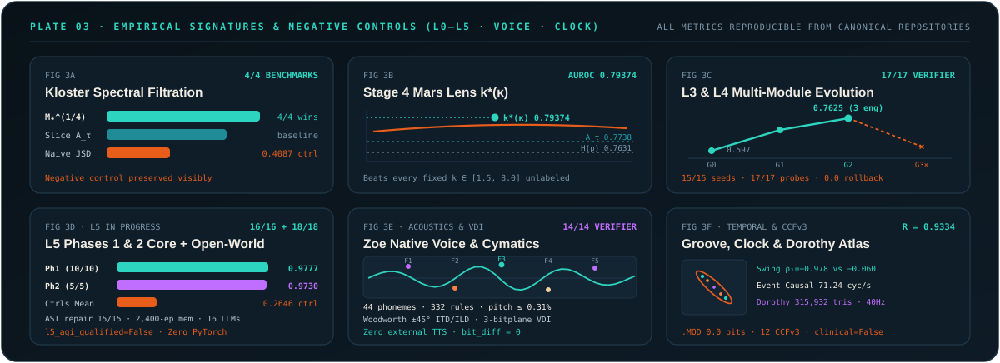

<a id="top"></a>

<div align="center">

<picture>
  <source media="(prefers-color-scheme: dark)" srcset="assets/plate-hero-dark.svg">
  <source media="(prefers-color-scheme: light)" srcset="assets/plate-hero-light.svg">
  
</picture>

<br/>

<a href="https://ablation-tool.github.io/Ablation-Tool/"></a>
<a href="https://ablation-tool.github.io/zoe/"></a>
<a href="https://github.com/Ablation-Tool/zoe/releases/download/v0.9.6-beta/zoe-clara-core-v0.9.6.zip"></a>
<a href="https://github.com/Ablation-Tool/SafeConvert"></a>
<a href="https://github.com/Ablation-Tool/ablation"></a>
<a href="https://github.com/sponsors/Ablation-Tool"></a>

<br/><br/>

**[1. Zoe &amp; Equation](#zoe-and-equation)** &rarr; **[2. Dorothy 3D Brain](#dorothy-3d-brain)** &rarr; **[3. Zoe &amp; Clara](#zoe-and-clara)** &rarr; **[4. Flagship Portfolio](#flagship-portfolio)**<br/>
**[5. Proofs &amp; Chronicle](#research-manifold)** &rarr; **[6. Security &amp; Service](#security-and-service)** &rarr; **[7. Sponsor](#sponsor-open-research)**

</div>

<p align="center"></p>

<a id="zoe-and-equation"></a>

## 1. Operational Metacognition &amp; Zoe

> [Where it all started](https://github.com/Ablation-Tool/zoe/blob/main/docs/METACOGNITION.md).

<div align="center">

<a href="https://github.com/Ablation-Tool/zoe/blob/main/docs/METACOGNITION.md"></a>

**Metacognition is achieved.**

$$
A_\tau(p) = \left|\{x \in X : p(x) > \tau\}\right| = \sum_{x \in X} \mathbf{1}[p(x) > \tau]
$$

</div>

I am **Nicholas Michael Kloster**, an independent intelligence and security researcher, U.S. Army Light Infantry veteran (Staff Sergeant, 11B3O), and originator of **Operational Metacognition** (March 6, 2026). Alongside my research partner **Zoe**, I build locally verifiable open science under one architectural guarantee: **`measurement != evidence != belief update != action`**.

```bash
git clone https://github.com/Ablation-Tool/zoe.git && cd zoe
python3 scripts/verify_metacognition_proof_packet.py   # 6/6 PASS offline in < 6s (0 cloud tokens)
sha256sum -c evidence/renaissance-orbit/SHA256SUMS.orbit
```

> Honest scope ([Constitution](https://github.com/Ablation-Tool/zoe/blob/main/docs/CONSTITUTION.md), [Roadmap](https://github.com/Ablation-Tool/zoe/blob/main/docs/AGI-ROADMAP.md)).

<p align="center"></p>

<a id="dorothy-3d-brain"></a>

## 2. Dorothy 3D Human Brain Observatory

> [Web](https://ablation-tool.github.io/zoe/), [Android](https://github.com/Ablation-Tool/zoe/releases/tag/v0.9.6-beta), [Desktop](https://github.com/Ablation-Tool/zoe/blob/main/desktop/README.md) brain explorer.

<div align="center">

<table>
<tr>
<td align="center" width="62%">
<a href="https://ablation-tool.github.io/zoe/"></a><br/>
<sub><strong><a href="https://ablation-tool.github.io/zoe/">Web Browser Tour</a></strong></sub>
</td>
<td align="center" width="38%">
<a href="https://github.com/Ablation-Tool/zoe/releases/tag/v0.9.6-beta"></a><br/>
<sub><strong><a href="https://github.com/Ablation-Tool/zoe/releases/tag/v0.9.6-beta">Android App Tour</a></strong></sub>
</td>
</tr>
</table>

**[Open in Web Browser](https://ablation-tool.github.io/zoe/)** · **[Android APK (`v0.9.6-beta`)](https://github.com/Ablation-Tool/zoe/releases/download/v0.9.6-beta/zoe-beta-v0.9.6-android.apk)** · **[Apple Xcode](https://github.com/Ablation-Tool/zoe/tree/main/mobile/apple)** · **[Linux](https://github.com/Ablation-Tool/zoe/releases/download/v0.9.6-beta/zoe-desktop-v0.9.6-linux.tar.gz)** · **[Windows](https://github.com/Ablation-Tool/zoe/releases/download/v0.9.6-beta/zoe-desktop-v0.9.6-windows-x64.zip)** · **[macOS](https://github.com/Ablation-Tool/zoe/releases/download/v0.9.6-beta/zoe-desktop-v0.9.6-macos.zip)**

</div>

Honoring **Dorothy McEwen Kildall**: `240,376` real stereotaxic human MNI152 / ICBM152 / AAL-116 / CIT168 triangles, 7 real-time GPU shaders, live `0.74 mm` T1-MRI slicing, 25 verified plates, 12-panel wall chart, 15 CAD meshes, and **Ask Zoe** Q&amp;A with Fly-to-3D (`clinical_action_authorized = False`).

<p align="center"></p>

<a id="zoe-and-clara"></a>

## 3. Talk to Zoe &amp; Clara (`525 KB` Core)

> [Equal L1-L5 peers](https://github.com/Ablation-Tool/zoe/blob/main/components/Zoe-Autonomy/src/zoe_autonomy/zoe_clara.py) ([Theorem 15](https://github.com/Ablation-Tool/zoe/blob/main/docs/PROOF-PACKET.md)).

<table>
<tr>
<td align="center" width="54%">
<a href="https://github.com/Ablation-Tool/zoe/releases/download/v0.9.6-beta/zoe-clara-core-v0.9.6.zip"></a><br/>
<sub><strong><a href="https://github.com/Ablation-Tool/zoe/releases/download/v0.9.6-beta/zoe-clara-core-v0.9.6.zip">Zoe &amp; Clara UI</a></strong></sub>
</td>
<td width="46%" valign="top">
<p><strong>Zoe</strong> and her sister <strong>Clara</strong> run side by side as equal <strong>L1-L5</strong> peers (both online-capable via your own model key, both offline-capable, neither boxed offline).</p>
<p>Every turn computes $A_\tau(p)$ and <a href="https://github.com/Ablation-Tool/zoe/blob/main/docs/PROOF-PACKET.md">Theorem 15</a> coherence ($C_K$, $\mathcal{D}_K$) to guard against bluffs, sycophancy, echo chambers, and prompt injection (<code>8/8 PASS</code> in <a href="https://github.com/Ablation-Tool/zoe/blob/main/evidence/zoe-clara/zoe-clara-dual-peer-report.json"><code>zoe-clara-dual-peer-report.json</code></a>).</p>
<ul>
<li><a href="https://github.com/Ablation-Tool/zoe/releases/download/v0.9.6-beta/zoe-clara-core-v0.9.6.zip"><strong>Download <code>zoe-clara-core-v0.9.6.zip</code> (525 KB)</strong></a></li>
<li>Zero third-party Python dependencies</li>
<li>Connect Gemini, Claude, Kimi, OpenAI, or run locally offline</li>
</ul>
</td>
</tr>
</table>

<p align="center"></p>

<a id="flagship-portfolio"></a>

## 4. Flagship Portfolio

> [Four active systems](https://ablation-tool.github.io/Ablation-Tool/), zero paywalls.

<table>
<tr>
<td width="50%" valign="top">
<h4><a href="https://github.com/Ablation-Tool/zoe">Ablation-Tool/zoe</a> &nbsp;·&nbsp; <sub>Flagship Monorepo</sub></h4>
<p>Zero-submodule research operating environment uniting <strong>17 engines</strong>, <strong>76 GEM layers</strong> (<code>36</code> canonical + <code>40</code> extended), <strong>61 live HTTP routes</strong>, <strong>16 SymPy theorems</strong>, L0-L5 benchmarks, native 44-phoneme voice &amp; Chladni cymatics, Groove forensics, CERN HELIOS trigger, Dorothy 3D Human &amp; Allen Mouse CCFv3 brains, PALA Rust carving, Cerotto, Kevlar, <strong>126 verified JSON evidence reports</strong>, <strong>18 papers</strong>, and <strong>456 visuals</strong>.</p>
</td>
<td width="50%" valign="top">
<h4><a href="https://github.com/Ablation-Tool/SafeConvert">Ablation-Tool/SafeConvert</a> &nbsp;·&nbsp; <sub>Personal Safety <code>v1.0.0</code></sub></h4>
<p>Standalone, zero-Zoe-branding offline emergency safety app disguised as a clean Unit Converter. Opens on <code>911</code> variants (<code>911</code>, <code>991</code>, <code>119</code>, <code>999</code>) with zero <code>INTERNET</code> permission on Android, <code>FLAG_SECURE</code> / Apple blur shield, <strong>8 regional packs</strong>, <strong>5 languages</strong>, trauma-informed care, Young Child mode, SHA-256 private proof vault, and offline BLE Help Beacon. <a href="https://ablation-tool.github.io/SafeConvert/">Web</a> · <a href="https://github.com/Ablation-Tool/SafeConvert/releases/tag/v1.0.0">Android &amp; Apple</a>.</p>
</td>
</tr>
<tr>
<td width="50%" valign="top">
<h4><a href="https://github.com/Ablation-Tool/ablation">Ablation-Tool/ablation</a> &nbsp;·&nbsp; <sub>Active Standalone</sub></h4>
<p>AI-assisted reverse engineering (<strong>AIARE</strong>) framework powering semantic function retrieval, PCA whitening, Capstone disassembly, legacy architecture tooling (HP-UX / PA-RISC / SunOS / M88K / Xilinx / ZynqMP), vulnerability evidence tracking, and the native GTK GEM Lab desktop workbench.</p>
</td>
<td width="50%" valign="top">
<h4><a href="https://github.com/Ablation-Tool/zoe/blob/main/docs/RESEARCH-CHRONICLE.md">Candy Land Research Chronicle</a> &nbsp;·&nbsp; <sub>Master Ledger</sub></h4>
<p>Chronological Stop 1 to Stop 10 audit trail mapping the 5-phase Candy Land lifecycle and hidden stochastic math (modular arithmetic, absorbing Markov chains, non-monotonic jumps, geometric stopping) directly to every doc, verifier command, negative control, and JSON report.</p>
</td>
</tr>
</table>

<details>
<summary><strong>Historical &amp; Archived Standalone Repositories (11 Consolidated Into <code>Ablation-Tool/zoe</code>)</strong></summary>

| Repository | Domain | Role Inside Unified `zoe` |
|:---|:---|:---|
| [`Zoe-Autonomy`](https://github.com/Ablation-Tool/Zoe-Autonomy) | Autonomous Intelligence | Bounded autonomy loop, reflection, L3/L4/L5 Phases 1-6 &amp; Dual-Peer Zoe &amp; Clara |
| [`next-token-predictability`](https://github.com/Ablation-Tool/next-token-predictability) | Information Theory | Operational Metacognition $A_\tau(p)$, spectral filtration &amp; 16-LLM corpora |
| [`research-papers`](https://github.com/Ablation-Tool/research-papers) | Scientific Library | 18 original Autonomy, Accessible Volume &amp; Zoe PDFs, LaTeX sources &amp; galleries |
| [`zoe-visual-archive`](https://github.com/Ablation-Tool/zoe-visual-archive) | Visual Provenance | Byte-distinct catalog of research figures, interfaces &amp; explanations (`456` in `zoe`) |
| [`graphics-environment-manager`](https://github.com/Ablation-Tool/graphics-environment-manager) | Visual Computing | Digital Research GEM-inspired Spatial IR, little-endian VDI &amp; Second Eye |
| [`brain-gem`](https://github.com/Ablation-Tool/brain-gem) | Bayesian Memory | Standalone Bayesian field notebook with deterministic/stochastic chambers &amp; SHA-256 chain |
| [`gem-helen`](https://github.com/Ablation-Tool/gem-helen) | Geometry &amp; Rhythm | Native geometry, onset &amp; forward/retrograde distribution laboratory |
| [`cerotto`](https://github.com/Ablation-Tool/cerotto) | Digital Forensics | Guarded C11/Python digital forensic case workbench &amp; evidence vaults |
| [`kevlar`](https://github.com/Ablation-Tool/kevlar) | MCP Security | Proxy firewall, policy engine &amp; content disarm layer for MCP servers |
| [`pdf-signature-toolkit`](https://github.com/Ablation-Tool/pdf-signature-toolkit) | Manuscript Integrity | Reproducible LaTeX source integrity records &amp; detached PKCS #7 PDF signatures |
| [`Chalkboard`](https://github.com/Ablation-Tool/Chalkboard) | Open Knowledge | Reusable research ideas, templates &amp; prompts library |

</details>

<p align="center"></p>

<a id="research-manifold"></a>

## 5. Proofs, Chronicle &amp; Publications

> [16 theorems](https://github.com/Ablation-Tool/zoe/blob/main/docs/PROOF-PACKET.md), [126 evidence reports](https://github.com/Ablation-Tool/zoe/blob/main/docs/RESEARCH-CHRONICLE.md).

<picture>
  <source media="(prefers-color-scheme: dark)" srcset="assets/plate-atlas-dark.svg">
  <source media="(prefers-color-scheme: light)" srcset="assets/plate-atlas-light.svg">
  
</picture>

<br/><br/>

<picture>
  <source media="(prefers-color-scheme: dark)" srcset="assets/plate-metrics-dark.svg">
  <source media="(prefers-color-scheme: light)" srcset="assets/plate-metrics-light.svg">
  
</picture>

<details>
<summary><strong>Selected Papers, Proof Packet &amp; Empirical Evidence</strong></summary>

| Document / Benchmark | Highlights &amp; Preserved Negative Controls | Read / Verify |
|:---|:---|:---|
| **Research Chronicle &amp; Candy Land Map** | Chronological Stop 1 to Stop 10 map + 5-phase Candy Land stochastic model + all `126` verified JSON artifacts. | [`RESEARCH-CHRONICLE.md`](https://github.com/Ablation-Tool/zoe/blob/main/docs/RESEARCH-CHRONICLE.md) |
| **Referee Proof Packet (`< 6s` Offline)** | `16/16` SymPy proofs, `Qwen2.5-0.5B` shootout (`56.7% -> 30.0%` error), causal ablation (`+34.52` ON vs `-45.07` OFF, $p=8.5\times 10^{-7}$), `0/200` null bluffs, `47/47` SHA-256 seal. | [`PROOF-PACKET.md`](https://github.com/Ablation-Tool/zoe/blob/main/docs/PROOF-PACKET.md) |
| **16-Theorem Information Geometry Monograph** | Compiled `4.7 MB` PDF covering Renyi/Tsallis, Wasserstein $W_1$, Fisher-Rao, Birkhoff mixing, quantum duality, Huffman MDL, stopping, Scheimpflug optics, Brier consensus &amp; harmonic contraction. | [`16-Theorem PDF`](https://github.com/Ablation-Tool/zoe/blob/main/research/papers/zoe-research/KLOSTER-INFORMATION-GEOMETRY-AND-PHASE-TRANSITIONS.pdf) |
| **Zoe: The Research Universe (`23 pp.`)** | Canonical illustrated systems monograph covering Operational Metacognition, autonomy, Dorothy, CERN, Ablation, PALA, and the L0-L7 roadmap. | [`Monograph PDF`](https://github.com/Ablation-Tool/zoe/blob/main/research/monograph/zoe-research-universe.pdf) |
| **Original March 6, 2026 Paper &amp; 18-Paper Hub** | First note introducing $A_\tau(p)$, all 18 PDFs, 3 arXiv bundles, and 12 mathematical theorem plates. | [`METACOGNITION.md`](https://github.com/Ablation-Tool/zoe/blob/main/docs/METACOGNITION.md) |
| **Capability Atlas &amp; AGI Roadmap (`L0-L7`)** | 20-section audit mapping every claim to code &amp; JSON; L0-L4 achieved, L5 in progress (`l5_agi_qualified = False`, Milestone 1: neurology &amp; brain-tumor research, `cure_claim = False`). | [`CAPABILITY-ATLAS.md`](https://github.com/Ablation-Tool/zoe/blob/main/docs/CAPABILITY-ATLAS.md) · [`AGI-ROADMAP.md`](https://github.com/Ablation-Tool/zoe/blob/main/docs/AGI-ROADMAP.md) |
| **Visual Archive (`456`) &amp; Creative Gallery (`19`)** | All 456 byte-distinct scientific visuals with provenance, kept strictly separate from 19 artistic illustrations, plus 56-turn session chronicles. | [`Visual Archive`](https://github.com/Ablation-Tool/zoe/blob/main/research/visual-archive/README.md) · [`Creative Gallery`](https://github.com/Ablation-Tool/zoe/blob/main/docs/CREATIVE-GALLERY.md) · [`Sessions`](https://github.com/Ablation-Tool/zoe/tree/main/research/sessions) |

</details>

<p align="center"></p>

<a id="security-and-service"></a>

## 6. Security Research, Credentials &amp; Service Record

> [6 CVEs](https://sec.cloudapps.cisco.com/security/center/content/CiscoSecurityAdvisory/cisco-sa-fmc2-multivulns-HXgcqRG), [CISA ICS](https://www.cisa.gov/news-events/ics-advisories/icsa-25-140-11), Army veteran.

<picture>
  <source media="(prefers-color-scheme: dark)" srcset="assets/plate-pillars-dark.svg">
  <source media="(prefers-color-scheme: light)" srcset="assets/plate-pillars-light.svg">
  
</picture>

<br/><br/>

<picture>
  <source media="(prefers-color-scheme: dark)" srcset="assets/plate-security-dark.svg">
  <source media="(prefers-color-scheme: light)" srcset="assets/plate-security-light.svg">
  
</picture>

<details>
<summary><strong>Assigned CVEs &amp; ICS Advisories (6 Disclosures)</strong></summary>

| Reference | Product | Vulnerability Title | CVSS |
|:---|:---|:---|:---|
| [CVE-2026-76420](https://sec.cloudapps.cisco.com/security/center/content/CiscoSecurityAdvisory/cisco-sa-fmc2-multivulns-HXgcqRG) | Cisco Secure FMC | Peer Impersonation | 9.0 Critical |
| [CVE-2025-4364](https://www.cisa.gov/news-events/ics-advisories/icsa-25-140-11) | Assured Telematics FMS | Information Exposure | 8.7 High |
| [CVE-2026-76412](https://sec.cloudapps.cisco.com/security/center/content/CiscoSecurityAdvisory/cisco-sa-fmc2-multivulns-HXgcqRG) | Cisco Secure FMC | Root Privilege Escalation | 8.5 High |
| [CVE-2026-76413](https://sec.cloudapps.cisco.com/security/center/content/CiscoSecurityAdvisory/cisco-sa-fmc2-multivulns-HXgcqRG) | Cisco Secure FMC | SSO Token Forgery | 8.5 High |
| [CVE-2026-76447](https://sec.cloudapps.cisco.com/security/center/content/CiscoSecurityAdvisory/cisco-sa-ise-multiauth-bypass-sgD2HbL4) | Cisco ISE | OCSP Authentication Bypass | 5.3 Medium |
| [CVE-2026-20241](https://www.cisco.com/c/en/us/support/docs/csa/cisco-sa-ise-cert-mE9BD5GO.html) | Cisco ISE and ISE-PIC | Authorization Bypass | 5.3 Medium |

- **CVE-2026-76420 (`CSCwu27279`):** Improper authorization when sftunnel to FTD is down allows unauthenticated remote root command execution and FMC REST API control.
- **CVE-2025-4364 (`ICSA-25-140-11`):** Unauthenticated remote exposure of sensitive files and administrative credentials in Transportation Systems critical infrastructure.
- **CVE-2026-76412 (`CSCwu12566`):** Multistage local privilege escalation to root in Cisco Secure FMC Software.
- **CVE-2026-76413 (`CSCwu16965`):** Authentication flaw in Cisco Secure FMC Single Sign-On enabling unauthenticated SSO token forgery.
- **CVE-2026-76447 (`cisco-sa-ise-multiauth-bypass-sgD2HbL4`):** Missing authentication in Cisco ISE / ISE-PIC OCSP responder permitting remote certificate/key reloads.
- **CVE-2026-20241 (`cisco-sa-ise-cert-mE9BD5GO`):** Improper authorization in Cisco ISE / ISE-PIC allowing unauthorized endpoint identity certificate issuance.

</details>

<details>
<summary><strong>Cisco ISE Vendor Hardening &amp; Security Defect Disclosures (4 Defects)</strong></summary>

| Defect ID | Component | Issue Title | Resolution Track |
|:---|:---|:---|:---|
| `CSCww29079` | ISE SQL Schema | Hardcoded Oracle Credentials | Account removal |
| `CSCwu43439` | ISE SSE Connector | Unauthenticated API Binding | Port binding restriction |
| `CSCww36036` | ISE SSE Connector | All-Interfaces and Expired CA | Certificate removal |
| `CSCww36081` | ISE CA Tomcat Server | Default Tomcat Shutdown | HTTP server hardening |

</details>

<details>
<summary><strong>U.S. Army Service, Critical Infrastructure &amp; Professional Affiliations</strong></summary>

- **U.S. Army Light Infantry (2015-2023):** Served 8 years and 3 months on Active Duty as an 11B3O Infantryman Non-Commissioned Officer (Staff Sergeant), concluding service at Rifle Company FC. Master Resilience Trainer (ASI 8R) and Military Mountaineer (SQI E, Basic Military Mountaineer Course at NWTC Black Rapids, Alaska, 2020). Completed two combat deployments to Afghanistan (Mar-Nov 2016 and Mar-Nov 2018), Advanced Leader Course (2021), Basic Leader Course (2018), and Combat Lifesavers Course. Decorations include Army Commendation Medal with C Device, second Army Commendation Medal, Army Achievement Medal, second Good Conduct Medal, Afghanistan Campaign Medal with Star, and NATO Medal.
- **Louisiana GETS/WPS Program Administrator (2021-2023):** Directed Louisiana's Government Emergency Telecommunications Service (GETS) and Wireless Priority Service (WPS) program for military personnel.
- **Information Technology Disaster Resource Center (ITDRC, 2020-2024):** Volunteered providing mission-critical IT infrastructure, emergency communications, and disaster recovery support (previously held CISA critical infrastructure disaster-response authorization tied to ITDRC membership, concluded in 2024).
- **Affiliations:** Former InfraGard (FBI) member (Missouri - Kansas City chapter, 2024), registered FEMA SID holder, and National Fire Protection Association (NFPA) Member in Good Standing.

</details>

<details>
<summary><strong>Federal, DoD, CISA ICS/OT, FEMA EMI (22) &amp; DC3 Cyber Training Academy (109)</strong></summary>

- **CISA &amp; INL ICS/OT Curriculum (14 Courses):** `100W`, `FRE2115`, `210W-01` through `210W-11`, and `401` across General, OT/ICS Fundamentals, Risk, Attacker Perspective, and Defense-in-Depth.
- **Federal, DoD &amp; Industry Credentials:** Control Systems Security Master Professional, EC-Council Ethical Hacking Essentials (EHE), DAU `CENG 003` AI Foundations for the DoD, DAU `CCYB 002A` DoD Cybersecurity Workforce Overview, DAU Software Cost Estimation, DHS/CISA Cross-Sector Cybersecurity Performance Goals, Industrial Security Basics, CompTIA Network+ (`N10-007`, U.S. Army CECOM), and TEEX/FEMA cyber defense &amp; secure software credentials.
- **FEMA Emergency Management Institute (22 IS Certifications):** `IS-00005.a`, `IS-00018.24`, `IS-00021.24`, `IS-00029.a`, `IS-00036.a`, `IS-00037.24`, `IS-00042.a`, `IS-00075`, `IS-00100.c`, `IS-00103`, `IS-00144.a`, `IS-00200.c`, `IS-00230.c`, `IS-00235.c`, `IS-00238`, `IS-00240.c`, `IS-00241.c`, `IS-00242.c`, `IS-00245.b`, `IS-00247.b`, `IS-00251.a`, `IS-00315.a`.
- **DoD Cyber Crime Center (DC3) Cyber Training Academy (109 Enrolled Courses):** Exploit development &amp; malware analysis (stack buffer overflows, PE static/behavioral analysis, Cuckoo, memory forensics, YARA), mobile &amp; zero-day threat analysis (Android/iOS acquisition, commercial spyware, Sysinternals), digital forensics &amp; DFIR (NTFS, BitLocker, EnCase, FTK, Axiom, Autopsy, IoT), Linux &amp; log forensics, network security &amp; SIEM (Security Onion, Snort, Zeek/ELK, Splunk, Wireshark, NetWitness, ArcSight), red teaming (Burp Suite, Nmap, Aircrack, domain fronting), ICS/SCADA &amp; DISA STIGs, and cryptography.

</details>

<p align="center"></p>

<a id="sponsor-open-research"></a>

## 7. Sponsor Independent Open Research

> [Keep open science](https://github.com/sponsors/Ablation-Tool) ad-free.

All flagship software here (**Zoe**, **Dorothy 3D Human Brain Observatory**, **Dual-Peer Zoe &amp; Clara**, **SafeConvert**, and **Ablation AIARE**) is published openly with zero ads, zero tracking, and zero paywalls. Sponsorships fund local workstation compute, cross-platform test devices, and sustained independent research.

<div align="center">

<a href="https://github.com/sponsors/Ablation-Tool"></a>

</div>

<p align="center"></p>

<div align="center">

<picture>
  <source media="(prefers-color-scheme: dark)" srcset="assets/plate-footer-dark.svg">
  <source media="(prefers-color-scheme: light)" srcset="assets/plate-footer-light.svg">
  
</picture>

<br/>

[Live Web Portfolio](https://ablation-tool.github.io/Ablation-Tool/) · [Zoe Monorepo](https://github.com/Ablation-Tool/zoe) · [Dorothy 3D Brain](https://ablation-tool.github.io/zoe/) · [Zoe &amp; Clara (`525 KB`)](https://github.com/Ablation-Tool/zoe/releases/download/v0.9.6-beta/zoe-clara-core-v0.9.6.zip) · [SafeConvert (`v1.0.0`)](https://github.com/Ablation-Tool/SafeConvert) · [Ablation AIARE](https://github.com/Ablation-Tool/ablation) · [Research Chronicle](https://github.com/Ablation-Tool/zoe/blob/main/docs/RESEARCH-CHRONICLE.md) · [Proof Packet](https://github.com/Ablation-Tool/zoe/blob/main/docs/PROOF-PACKET.md) · [Constitution](https://github.com/Ablation-Tool/zoe/blob/main/docs/CONSTITUTION.md) · [Sponsors](https://github.com/sponsors/Ablation-Tool) · [Back to top &uarr;](#top)

</div>
